# Agentic AI Medical Record Summarization — Architecture & Implementation Guide

**Line of business:** Workers' Compensation (WC)
**Application:** Agentic AI platform for medical-record intake, classification, clinical summarization, milestone extraction, guideline review, chronology generation and human-in-the-loop decisioning
**Technology stack:** React (frontend) · FastAPI / Python (backend) · SQLite (database) · Google Gemini via Google AI Studio API keys (LLM) · LangGraph (agent orchestration)
**Source documents:**
- `Medical Management PoC.docx` — "Workers Compensation: Medical Records Summarization using AI — End-to-End Process Summary — 7-Stage Intake & Summary"
- `Medical Record Summarization — Persona Walkthrough.docx` — "Step-by-Step Instructions by Persona"

**Document version:** 1.0 · **Date:** 09-Oct-2026 · **Status:** Implementation-ready draft

---

## Table of Contents

1. [Executive Summary and Scope](#1-executive-summary-and-scope)
2. [Source Requirements Traceability Matrix](#2-source-requirements-traceability-matrix)
3. [Personas, Roles and Access Control](#3-personas-roles-and-access-control)
4. [High-Level Architecture](#4-high-level-architecture)
5. [Technology Integration: React, FastAPI, SQLite, Gemini, LangGraph](#5-technology-integration-react-fastapi-sqlite-gemini-langgraph)
6. [Agent Orchestration Design](#6-agent-orchestration-design)
7. [Agent Catalog](#7-agent-catalog)
8. [Tools Layer](#8-tools-layer)
9. [End-to-End Workflow: Stage by Stage](#9-end-to-end-workflow-stage-by-stage)
10. [Data Pipeline](#10-data-pipeline)
11. [Database Schema (SQLite)](#11-database-schema-sqlite)
12. [API Endpoint Definitions (FastAPI)](#12-api-endpoint-definitions-fastapi)
13. [Frontend Design (React)](#13-frontend-design-react)
14. [Error Handling and Resilience](#14-error-handling-and-resilience)
15. [Security and Compliance](#15-security-and-compliance)
16. [Logging, Monitoring and Audit Trails](#16-logging-monitoring-and-audit-trails)
17. [Evaluation and Quality Assurance](#17-evaluation-and-quality-assurance)
18. [Project Structure and Step-by-Step Implementation Guide](#18-project-structure-and-step-by-step-implementation-guide)
19. [Assumptions, Dependencies, Limitations and Future Improvements](#19-assumptions-dependencies-limitations-and-future-improvements)
20. [Appendices](#20-appendices)

---

## 1. Executive Summary and Scope

### 1.1 Problem

Claims adjusters and Nurse Case Managers (NCMs) on workers' compensation claims receive medical documentation as faxes, mail and email: high volume, mixed formats, unstructured bundles. Today they:

- manually inspect files to tell Provider Notes, Rehab Notes and incoming bills apart;
- spend hours separating Operative Reports, IME Reports and Rehab Notes into folders, where misfiled documents or lost pages delay the file;
- read dense multi-page charts line by line, suffering cognitive fatigue and time pressure;
- scan text blocks for dates and milestones and can miss critical turning points such as **Maximum Medical Improvement (MMI)**;
- manually cross-reference doctors' recommendations against state rules and guidelines that are complex and shift across jurisdictions;
- hand-type chronologies, status updates and clinical summaries for file reviews or defence counsel;
- verify their own notes, make approval and denial decisions, and log actions in the Claims Management System (CMS), which creates a bottleneck at the human-decision layer.

### 1.2 Scope (verbatim intent from the PoC)

> Process and summarize medical documentation associated with injured-worker claims, enabling claims adjusters and Nurse Case Managers to efficiently understand treatment progression, identify key medical milestones and focus attention on cases requiring further review.

### 1.3 Target business outcome

> Reduce manual review of **200–500 pages** to a **one-page actionable summary**, **automate milestone tracking** and **direct complex or exceptional cases** to the appropriate claims or clinical professionals.

### 1.4 Solution in one paragraph

A React web application lets the Medical Records / Summarization Team upload a claim's medical-record package. A FastAPI backend stores the files, creates a claim record in SQLite and starts a **LangGraph** workflow. Specialized **agents**, one per business stage, call **tools** (PDF/OCR, classifier, deduplicator, date normalizer, guideline retriever, citation resolver, report templater, CMS connector) and the **Gemini** LLM. They produce a classified and de-duplicated document index, a chronological timeline, a clinical summary, extracted milestones (MMI, Return-to-Work (RTW), treatment plan) with page-level citations, guideline-deviation flags (ODG/ACOEM), a structured medical chronology and an MMI status report. The workflow **pauses at human-in-the-loop (HITL) checkpoints** where the NCM, Clinical/Utilization Reviewer, Claims Examiner and Claims Supervisor validate, edit, approve or escalate. Every agent step, tool call, LLM call and human action is persisted for **audit and traceability**.

### 1.5 In scope / out of scope

| In scope | Out of scope (v1) |
|---|---|
| All 7 business stages from both source documents | Automated payment of medical bills |
| All 6 personas plus the WC Attorney / defence counsel (read and export) | Real integration with a production CMS (a mocked connector is provided, see §8) |
| Sample WC package (Marcus T. Delgado, 287 pages) as the golden test case | Licensed ODG/ACOEM content (a pluggable guideline store is provided, see §19) |
| Upload of PDF, TIFF, JPEG/PNG, DOCX, EML (with attachments) | Live fax-server or email-inbox polling (designed as a future connector) |
| Single-tenant deployment using SQLite | Multi-tenant SaaS and horizontal scaling (migration path in §19) |

---

## 2. Source Requirements Traceability Matrix

This matrix maps **every** requirement in both source documents to the component that implements it. IDs are used throughout this document. Column legend: **Agent** = LangGraph node (§7), **HITL** = human checkpoint (§6.5), **API** = endpoint group (§12), **Tables** = SQLite tables (§11).

> **Note on stage numbering:** The Persona Walkthrough subtitle says "Stages 1–8", but the body defines **7 stages**, identical to the PoC's 7 stages. This design implements 7 stages. "Stage 8" is treated as the post-decision **Document, communicate and maintain the decision record** activity, which the walkthrough places as Stage 7 Step 3 and which this design implements as the `record_keeping` node (§7.10).

### 2.1 PoC stage requirements (Manual vs AI target)

| ID | PoC stage | Manual pain point / key challenge | AI target (requirement) | Implemented by |
|---|---|---|---|---|
| POC-1 | Medical Record Intake | Faxes, mail, emails; staff inspect files for Provider Notes, Rehab Notes, incoming bills. *High volume, mixed formats, unstructured bundles.* | **Automated ingestion**: instant ingestion of document feeds; automatically identify incoming file packets and route them by **document-type metadata tags**, e.g. separating a physical fax into distinct streams for Provider Notes vs billing. | `intake_agent`, `ingest_tool`, `packet_splitter_tool`; API `/claims`, `/documents`; tables `documents`, `pages`, `document_streams` |
| POC-2 | Document Classification and Processing | Sorting unstructured pages; hours separating Operative Reports, IME Reports, Rehab Notes. *Misfiled documents or lost pages delay the file.* | **Smart document classification**: read headers, layouts and contextual phrases; instant **auto-sorting and indexing** of Operative Reports, IME Reports, Rehab Notes and Treatment Plans. | `classification_agent`, `organization_agent`; tables `document_classifications`, `document_index` |
| POC-3 | Medical Record Review and Clinical Understanding | Reading charts line by line. *Cognitive fatigue and time constraints.* | **Contextual clinical summarization**: condense longitudinal histories into brief progress summaries; **executive health summaries** highlighting key narrative changes for NCMs and adjusters. | `clinical_summary_agent`, `utilization_agent`; table `summaries` |
| POC-4 | Identification of Key Facts and Milestones | Scanning text for dates and milestones. *Easy to miss MMI.* | **Targeted data-point harvesting**: precise extraction of clinical and legal milestones; specialized routines for **MMI extraction**, **RTW extraction** (restrictions), **treatment-plan extraction**. | `extraction_agent` (MMI, RTW and treatment-plan sub-extractors), `validation_agent`; tables `extracted_facts`, `milestones`, `citations` |
| POC-5 | Treatment and Guideline Review | Cross-referencing recommendations against state rules. *Complex, shifting guidelines across jurisdictions.* | **Guideline and deviation matching** against official treatment guidelines (ODG, ACOEM); **treatment deviation analysis** flagging **off-guideline therapy requests**, **excessive duration**, **stalled recovery patterns**. | `guideline_agent`, `guideline_retrieval_tool`; tables `guideline_rules`, `guideline_findings` |
| POC-6 | Chronology and Summary Preparation | Hand-typing chronologies and summaries for file reviews or defence counsel. *Tedious, repetitive documentation.* | **Automated templating and reporting** into standardized templates; generation of **MMI status reporting**, **structured medical chronologies**, **case-progress summaries ready for export**. | `chronology_agent`, `report_agent`, `report_template_tool`; API `/reports`; tables `chronology_events`, `reports` |
| POC-7 | User Review and Action | Reviewing notes, verifying data entry, approval/denial decisions, logging in CMS. *Bottleneck at human-decision layer.* | **HITL validation**: review AI-highlighted flags (MMI status, RTW limits) with **one-click approvals**; streamline decision workflows. | `decision_support_agent`, `routing_agent`, `record_keeping` node, `cms_connector_tool`; API `/reviews`, `/decisions`; tables `reviews`, `decisions`, `audit_log` |
| POC-OUT | End-to-end outcome | — | 200–500 pages → one-page actionable summary; automated milestone tracking; route complex or exceptional cases to the right professional. | `report_agent` (one-page summary), `milestones` table and dashboard, `routing_agent` |
| POC-SAMPLE | Sample medical record | — | Self-contained WC sample package (Appendix A) with 9 document types and their expected contents. | Golden dataset (§17), seed data (§18) |

### 2.2 Persona Walkthrough step requirements

| ID | Stage / Step | Action (requirement) | Persona | Working from (inputs) | What good looks like (acceptance criteria) | Agent / HITL |
|---|---|---|---|---|---|---|
| PW-1.1 | Intake / 1 | Identify claim, injured worker, injury date, body part; establish review goals and applicable time window. | Summarization Team / Claims Adjuster | FROI; Employer's Accident Report; Initial Medical Documentation; Policy and Coverage Information | 100% accuracy on baseline data; flawless time-window management; clear, actionable review goals | `intake_agent` (baseline extraction plus review-goal draft) → HITL-0 (optional baseline confirm) |
| PW-1.2 | Intake / 2 | Review record completeness and prioritize: find missing documents, duplicates, urgent details, items needing immediate attention. | Claims Adjuster | Medical record package, claim file, document inventory | Zero file clutter; proactive document chasing; instant identification of urgency | `intake_agent` (completeness check, urgency flags), `dedup_tool`, `document_request` records |
| PW-1.3 | Intake / 3 | Establish review context: the question the review must answer and the evidence required. | Claim Examiner / Claims Adjuster | Comprehensive Medical Records; Utilization Requests; Evidence-Based Treatment Guidelines | Precise, narrowly defined clinical question; identification of required evidence; alignment with guidelines and state rules; efficiency for summarization teams | `intake_agent` (review-context builder) → stored in `review_contexts` |
| PW-2.1 | Classification / 1 | Classify records by provider, date, document type, encounter, body part, treatment, imaging, surgery, therapy, work status, etc. | Medical Records / Summarization Team | Bulk faxes or PDF uploads with hundreds of mixed pages from doctors, hospitals, PT clinics | Flawless granular tagging; separation of noise from value; instant searchability | `classification_agent`, FTS5 search index |
| PW-2.2 | Classification / 2 | Arrange documents in timeline order, group related care visits, remove duplicates and administrative noise. | Summarization Team | Thousands of pages spanning years and specialties (primary care, orthopedics, PT, chiropractic, pain management) | Flawless chronological timeline; logical episode grouping; zero administrative noise and duplicates | `organization_agent` (episodes, dedup, noise filter) |
| PW-2.3 | Classification / 3 | Check that all required records are present and the sequence correctly captures the clinical timeline. | Nurse Case Manager | Indexed, classified, chronologically sorted packet | Zero gaps in timeline; chronological integrity; cross-validation of provider notes | `organization_agent` (gap detection) → **HITL-1 NCM Timeline Check** |
| PW-3.1 | Clinical review / 1 | Understand symptoms, diagnoses, tests, treatments, recovery progress, daily functioning, work limitations. | Nurse Case Manager | Physician exam notes, progress reports, work status slips, FCEs, provider restrictions | Comprehensive clinical summary; clear functional and work limitations; objective evidence alignment | `clinical_summary_agent` |
| PW-3.2 | Clinical review / 2 | Clinical/utilization assessment: medical necessity, appropriateness, progression, unresolved questions. | Medical Reviewer / Utilization Reviewer | Organized chronology; ODG/ACOEM; provider requests (MRI, ESI, PT extensions, surgery) | Objective medical necessity; clear identification of barriers; actionable clinical outcomes | `utilization_agent` (draft) → confirmed at HITL-4 |
| PW-3.3 | Clinical review / 3 | Surface inconsistencies, conflicting diagnoses, unexplained treatment changes, missing evidence. | Clinical Reviewers | Formatted record and chronology; jurisdictional guidelines and protocols | Spotting discrepancies early; targeted fact-finding; setting up defensible decisions | `utilization_agent` (conflict detector) → `clinical_issues` |
| PW-4.1 | Extraction / 1 | Extract injury mechanism, symptoms, diagnoses, imaging, procedures, treatment, response, restrictions, work status, recommendations. | Summarization Team | Organized timeline and source records; previous review notes | Structured, standardized extraction; focus on functional outcomes (response plus restrictions, which drive indemnity) | `extraction_agent` |
| PW-4.2 | Extraction / 2 | Validate facts and milestones against source; resolve discrepancies. | Clinical Reviewer | Draft summary or extraction report; original source records | Traceability (page-and-line citations); active discrepancy resolution; **zero extrapolation** | `validation_agent` (automatic grounding check) → **HITL-2 Clinical Fact Validation** |
| PW-4.3 | Extraction / 3 | Highlight key events that shifted diagnosis, plan, outlook, functioning or work capacity. | Nurse Case Manager | Validated chronology and facts; key diagnostic and surgical reports | Pinpointing true turning points; tracking trajectory changes in work capacity; connecting treatment response to outlook | `extraction_agent` (turning-point detector) |
| PW-5.1 | Guideline review / 1 | Gather and document injury details, symptom progression, objective findings, plans, responses, current work status. | Medical Reviewer / Utilization Reviewer | Validated chronological packet; extraction and milestone notes | Complete clinical narrative arc; structured, scannable formatting; audit-ready citations | `guideline_agent` (case-fact assembly) |
| PW-5.2 | Guideline review / 2 | Identify clinically significant milestones that materially changed diagnosis, treatment, prognosis, function or work status. | Clinical Reviewer | Validated timeline; diagnostic reports, surgical notes, FCEs | Clear cause-and-effect mapping (how an event altered the claim); direct link to work capacity | `guideline_agent` (impact mapping plus deviation analysis) |
| PW-6.1 | Output / 1 | Build the clinical chronology: injury, evaluations, diagnoses, diagnostics, treatment, response, functional changes, work status. | Summarization Team | Validated, deduplicated records; extracted facts and milestones | Flawless sequential flow; comprehensive data integration; page-level traceability | `chronology_agent` |
| PW-6.2 | Output / 2 | Create the clinical narrative: injury → diagnosis → treatment → response → function → current status. | Medical Records / Summarization Team | Built chronology; identified milestones | Defensible clarity (no unverified assumptions or bias); filter administrative and clinical noise; focus on milestones driving approval, cost exposure, occupational recovery | `report_agent` (narrative plus one-page summary) |
| PW-6.3 | Output / 3 | Review and contextualize the summary; validate accuracy, significance, alignment with review purpose. | Nurse Case Manager | Draft summary, underlying records, claim context | Summary answers the claim question and highlights evidence for the next decision | **HITL-3 NCM Summary Review** |
| PW-7.1 | Action / 1 | Translate evidence and jurisdictional rules into a decision or recommendation on treatment, disability and claim trajectory. | Claims Examiner | Clinical summary, claim file, guideline findings, work status, prior decisions | Decision supported by documented evidence and appropriate to claim context | `decision_support_agent` → **HITL-4 Claims Decision** |
| PW-7.2 | Action / 2 | Clinical/utilization determination where required; document clinical rationale. | Medical Reviewer / Utilization Reviewer | Medical record, summary, guidelines, treatment request | Determination clearly connects evidence and criteria to conclusion | **HITL-4 UR Determination** (parallel branch) |
| PW-7.3 | Action / 3 | Document, communicate, maintain decision record: rationale, evidence, open questions, next steps, follow-up. | Claims Supervisor / Claims Manager | Medical review, summary, claim documentation | Final record clear, defensible, traceable, actionable; another reviewer can understand how the decision was reached | `record_keeping` node → **HITL-5 Supervisor Sign-off** (for escalated or high-risk claims), `cms_connector_tool`, `audit_log` |
| PW-PURPOSE | Purpose statement | Walk through intake/organization → clinical summarization → treatment/risk assessment → work-status evaluation → claims decision-making using the sample packages. | All personas incl. WC Attorney | Sample WC packages | End-to-end walkthrough possible on sample data | Seed data and demo mode (§18), Attorney read-only role (§3) |

### 2.3 Persona responsibility requirements

| ID | Persona (as written in source) | Responsibility | Where supported |
|---|---|---|---|
| PR-1 | Claims Examiner (also "Claims Adjuster", "Claim Examiner") | Reviews summarized history to understand claim, injury, treatment progression, work status, restrictions, **potential claim exposure**; supports claims decisions and next steps. | Claim dashboard, exposure indicators, HITL-4 decision screen |
| PR-2 | Nurse Case Manager | Reviews clinical info, tracks treatment and recovery, **identifies gaps or delays in care**, **coordinates providers**, **monitors return-to-work progress**. | HITL-1 and HITL-3, gap/delay alerts, provider directory, RTW tracker |
| PR-3 | Medical Reviewer / Utilization Reviewer (also "Clinical Reviewer(s)") | Evaluates diagnoses, plans, medical necessity, objective findings, clinical progression; identifies inconsistencies. | HITL-2, UR determination screen, clinical issues list |
| PR-4 | Claims Supervisor / Claims Manager (also "UW Manager") | Oversees handling, validates findings and decisions, reviews high-risk or complex claims, ensures escalation and compliance. | Supervisor console, escalation queue, HITL-5 sign-off, compliance reports |
| PR-5 | Medical Records / Summarization Team | Collects, organizes, deduplicates and summarizes records into a structured chronology highlighting diagnoses, treatments, findings, restrictions, significant changes. | Upload/intake screen, classification review, chronology editor |
| PR-6 | Summarization Team | Extracts information, builds timeline, identifies key events and gaps, produces review-ready summary for human validation. | Same role as PR-5 in RBAC (`summarization_team`), with extraction-review rights |
| PR-7 | Workers' Compensation Attorney / defence counsel | Named in the walkthrough purpose and PoC Stage 6 ("defence counsel"). Consumes chronologies and summaries. | `attorney` read-only role with export of approved reports |

---

## 3. Personas, Roles and Access Control

### 3.1 Role model

Roles are stored in `roles` and assigned through `user_roles` (§11). Permissions are enforced in FastAPI dependencies (`require_permission("...")`) and mirrored in the React UI to hide unavailable actions. **The backend is the source of truth.**

| Role key | Persona | Primary screens | HITL checkpoints owned |
|---|---|---|---|
| `summarization_team` | Medical Records / Summarization Team, Summarization Team | Upload & Intake, Document Index, Classification Review, Extraction Review, Chronology Editor | HITL-0 Baseline Confirm (shared with adjuster) |
| `claims_examiner` | Claims Examiner / Adjuster | Claim Dashboard, One-Page Summary, Flags & Approval Queue, Decision screen | HITL-0, HITL-4 Claims Decision |
| `nurse_case_manager` | Nurse Case Manager | Timeline View, Clinical Summary, RTW Tracker, Gaps & Delays | HITL-1 Timeline Check, HITL-3 Summary Review |
| `clinical_reviewer` | Medical Reviewer / Utilization Reviewer / Clinical Reviewer | Fact Validation (side-by-side source viewer), Guideline Findings, UR Determination | HITL-2 Fact Validation, HITL-4 UR Determination |
| `claims_supervisor` | Claims Supervisor / Claims Manager / UW Manager | Supervisor Console, Escalation Queue, Audit Viewer, Metrics | HITL-5 Supervisor Sign-off, reassignment, override |
| `attorney` | WC Attorney / defence counsel | Approved Reports (read only), Chronology export | None |
| `admin` | IT / platform admin | User management, guideline store, prompt and model config, system health | None (cannot alter clinical content) |

### 3.2 Permission matrix

| Permission | summ. team | examiner | NCM | clinical rev. | supervisor | attorney | admin |
|---|---|---|---|---|---|---|---|
| `claim:create` | ✔ | ✔ | | | ✔ | | |
| `document:upload` | ✔ | ✔ | ✔ | | ✔ | | |
| `document:view_phi` | ✔ | ✔ | ✔ | ✔ | ✔ | ✔ (approved only) | |
| `classification:edit` | ✔ | | ✔ | | ✔ | | |
| `timeline:approve` (HITL-1) | | | ✔ | | ✔ | | |
| `fact:validate` (HITL-2) | | | | ✔ | ✔ | | |
| `summary:edit` / `summary:approve` (HITL-3) | edit | | ✔ | | ✔ | | |
| `decision:make` (HITL-4) | | ✔ | | | ✔ | | |
| `ur:determine` (HITL-4 UR) | | | | ✔ | | | |
| `decision:signoff` (HITL-5) | | | | | ✔ | | |
| `report:export` | ✔ | ✔ | ✔ | ✔ | ✔ | ✔ | |
| `audit:view` | | | | | ✔ | | ✔ (metadata only) |
| `config:manage` | | | | | | | ✔ |

### 3.3 Separation-of-duties rules

1. The user who **makes** a HITL-4 decision cannot **sign off** HITL-5 on the same claim.
2. A UR determination (PW-7.2) can only be recorded by a `clinical_reviewer`. AI output is always labeled *"AI draft — not a determination"*.
3. `admin` can manage prompts, models and guideline content but has **no PHI access** by default.
4. Every override of an AI flag requires a free-text reason, which is stored in `reviews.reason` and `audit_log`.

---

## 4. High-Level Architecture

### 4.1 Logical architecture

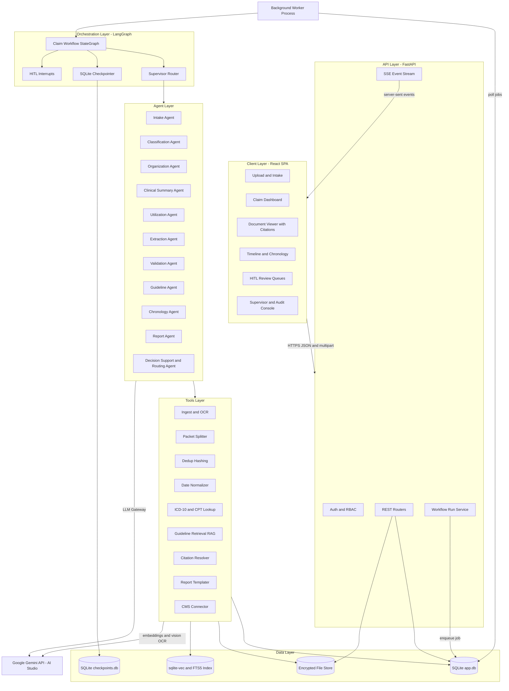

### 4.2 Architectural principles

| Principle | How it is applied |
|---|---|
| **Stage = node** | Each business stage from the source documents is one or more LangGraph nodes, so the business process and code map 1:1 (traceability §2). |
| **Agents propose, humans dispose** | AI outputs are drafts. Clinical or legal determinations (MMI acceptance, UR determination, claim decision) require HITL approval. |
| **Grounded or nothing** | Every extracted fact must carry a citation (`document_id`, `page_number`, `line_start`–`line_end`, `quote`). Ungrounded facts are rejected by the Validation Agent ("zero extrapolation", PW-4.2). |
| **Deterministic where possible** | Hashing, date parsing, code lookup, timeline sorting and template rendering are plain Python tools, not LLM calls. The LLM is used only for understanding and language. |
| **Durable, resumable workflows** | LangGraph state is checkpointed to SQLite after every node, so a crash or a 429 quota error resumes from the last good step. |
| **Event-sourced audit** | Every state transition, LLM call, tool call and human action is appended to `audit_log` and the agent telemetry tables. |
| **Swap-friendly** | LLM provider (Gemini → Vertex AI → other), DB (SQLite → PostgreSQL), file store (local → S3/GCS) and job queue (SQLite jobs → Redis/Celery) sit behind interfaces. |

### 4.3 Deployment view (v1)

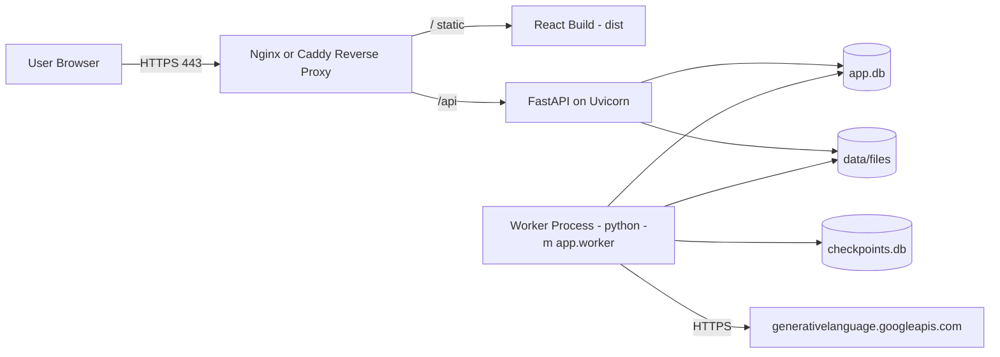

A single VM or container host runs: reverse proxy, the FastAPI app (API process) and one **worker process** that executes LangGraph runs. Both processes share the SQLite files on the same local disk; SQLite must **not** be placed on a network share (§11.4).

---

## 5. Technology Integration: React, FastAPI, SQLite, Gemini, LangGraph

### 5.1 Responsibilities of each technology

| Layer | Technology | Responsibility |
|---|---|---|
| Presentation | **React 18 + TypeScript + Vite**, React Router, TanStack Query, a component library (MUI or shadcn/ui), `react-pdf` for document viewing | Screens per persona, upload, live run progress, side-by-side citation viewer, HITL forms, exports |
| API | **FastAPI** (Python 3.11+), Pydantic v2, Uvicorn, `sse-starlette` | REST endpoints, auth/RBAC, validation, file intake, run control (start/resume/cancel), event streaming |
| Orchestration | **LangGraph** (`langgraph`, `langgraph-checkpoint-sqlite`) | Stateful workflow graph, conditional routing, retries, HITL `interrupt()` and `Command(resume=...)`, checkpoints |
| LLM | **Google Gemini** via `google-genai` SDK, keys from **Google AI Studio** | Classification, summarization, extraction (structured JSON output), reasoning, vision OCR for scanned faxes, embeddings |
| Persistence | **SQLite** via SQLAlchemy 2.0 + Alembic; FTS5 for full-text search; `sqlite-vec` for vectors | Business data, telemetry, audit, jobs, search indexes, LangGraph checkpoints (separate file) |
| Files | Local encrypted directory (`data/files/{claim_id}/...`) | Original uploads, per-page PNG renders, generated reports |

### 5.2 End-to-end data flow

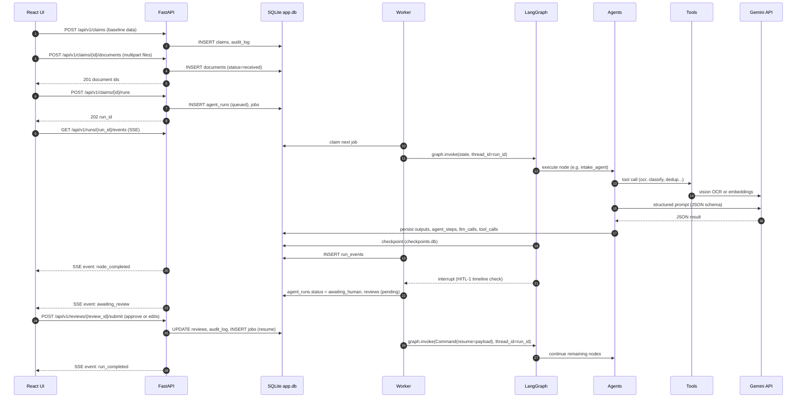

### 5.3 How React integrates with FastAPI

- **Transport:** JSON over HTTPS for CRUD; `multipart/form-data` for uploads (chunked uploads for files over 50 MB, §12.3); **Server-Sent Events (SSE)** for one-way live progress. SSE is preferred over WebSockets because the flow is server→client only, it works through proxies, and the browser reconnects automatically via `Last-Event-ID`.
- **Auth:** OAuth2 password flow or SSO (OIDC) that issues a short-lived **JWT access token** (15 min) plus an **httpOnly refresh cookie**. React keeps the access token in memory only, never in `localStorage`.
- **Data fetching:** TanStack Query handles caching and invalidation. When an SSE event `node_completed{node:"extraction_agent"}` arrives, the UI invalidates `['claims', id, 'facts']`.
- **API client:** generated from FastAPI's OpenAPI schema (`openapi-typescript`) so request and response types stay in sync.
- **CORS:** in development Vite proxies `/api` to `localhost:8000`; in production the same origin sits behind the reverse proxy, so CORS is not needed.

### 5.4 How FastAPI integrates with LangGraph

FastAPI does **not** run long workflows inside request handlers. A 287-page package can take minutes and HITL pauses can last days.

1. `POST /runs` writes `agent_runs` (status `queued`) and a row in `jobs` (`type=start_run`).
2. A separate **worker process** (`python -m app.worker`) polls `jobs` with `UPDATE ... RETURNING` to claim one job atomically, then calls:

```python
config = {"configurable": {"thread_id": run_id}}
graph.invoke(initial_state, config=config)          # start
graph.invoke(Command(resume=review_payload), config) # resume after HITL
```

3. When a node calls `interrupt(payload)`, LangGraph persists the checkpoint and returns. The worker marks the run `awaiting_human` and creates a `reviews` row from the interrupt payload.
4. `POST /reviews/{id}/submit` validates the human input, writes it, and enqueues a `resume_run` job.
5. The worker emits `run_events` rows; the SSE endpoint tails them for the client (polling every 1 s on SQLite, or via an in-process pub/sub when API and worker share a process in dev).

> **Why a worker process instead of FastAPI `BackgroundTasks`:** `BackgroundTasks` die with the API process, cannot be retried, and compete with request handling. The SQLite `jobs` table gives a durable queue without adding Redis to the stack. It can be swapped for Celery/RQ + Redis later (§19).

### 5.5 How LangGraph integrates with SQLite

- **Business data** (`app.db`): agents write outputs through repository functions (SQLAlchemy). Graph state holds **IDs and small summaries**, not page text, so checkpoints stay small.
- **Checkpoints** (`checkpoints.db`): `langgraph.checkpoint.sqlite.SqliteSaver` (or `AsyncSqliteSaver`) stores the state after each super-step, keyed by `thread_id = run_id`. A separate file avoids lock contention with business writes.
- **Search**: FTS5 virtual table `pages_fts` (keyword search) and `sqlite-vec` virtual table `page_chunk_vectors` (semantic search with Gemini embeddings), both in `app.db`.

### 5.6 How the agents integrate with Gemini (LLM Gateway)

All LLM calls go through one module, `app/llm/gateway.py`, which provides:

| Concern | Implementation |
|---|---|
| Client | `from google import genai; client = genai.Client(api_key=settings.GEMINI_API_KEY)` (key from `.env`, never exposed to React) |
| Model routing | `MODEL_FAST` (e.g. `gemini-2.5-flash`) for classification, OCR and short extraction; `MODEL_REASONING` (e.g. `gemini-2.5-pro`) for clinical summary, utilization, guideline reasoning and the narrative. Names are configurable in `.env`, so newer Gemini models can be adopted without code change. |
| Structured output | `config={"response_mime_type": "application/json", "response_schema": PydanticModel}` followed by Pydantic validation, with one automatic repair retry |
| Multimodal | Scanned pages are sent as image parts (`types.Part.from_bytes(png, mime_type="image/png")`) for OCR plus layout cues |
| Long context | Gemini's long context window allows whole-document prompts. The gateway still chunks by **document/episode** to control cost, latency and citation precision. |
| Embeddings | `client.models.embed_content(model=EMBED_MODEL, contents=[...])` (e.g. `gemini-embedding-001`) |
| Safety | Safety settings tuned so that clinical content (injury, surgery, medication) is not blocked; blocked responses are logged and routed to HITL |
| Resilience | Token-bucket rate limiter per model (matching AI Studio RPM/TPM limits), exponential backoff with jitter on 429/5xx, circuit breaker (§14) |
| Telemetry | Each call writes to `llm_calls`: model, prompt template id and version, input/output tokens, latency, cost estimate, status, run/step ids. Prompt and response bodies are stored encrypted, or redacted per config (§15). |
| Determinism | `temperature=0` for classification and extraction; `0.2–0.4` for narrative text |

---

## 6. Agent Orchestration Design

### 6.1 Orchestration pattern

The workflow uses a **hybrid supervisor + pipeline** pattern:

- The **main path is a deterministic pipeline** that mirrors the 7 business stages, because the business process is ordered and auditors need predictability.
- A **Supervisor Router** node, implemented in Python with rules and optionally asking the LLM, decides at defined branch points whether to loop back (e.g. re-classify after an NCM correction), request missing documents, run optional sub-agents (e.g. IME analysis only when IME reports exist), or escalate.
- **Parallel fan-out** is used where steps are independent: per-document classification, and the MMI, RTW and treatment-plan extractors.
- **HITL interrupts** sit exactly where the Persona Walkthrough assigns a human validation step.

### 6.2 Workflow graph

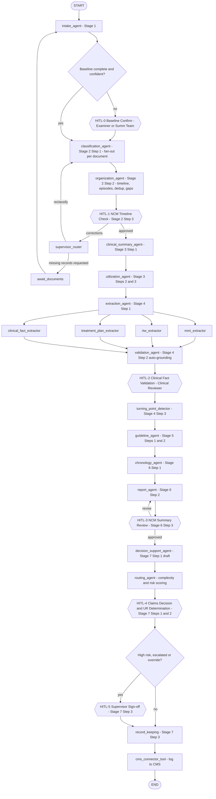

### 6.3 Graph state schema

State is a `TypedDict` with reducers. Large artifacts live in SQLite and the state carries references.

```python
from typing import Annotated, Literal, TypedDict
import operator

class ClaimWorkflowState(TypedDict):
    # identity
    run_id: str
    claim_id: str
    initiated_by: str                       # user id
    # stage tracking
    current_stage: Literal["intake","classification","clinical_review",
                           "extraction","guideline_review","output","action","done"]
    stage_status: dict[str, str]            # {"intake":"completed", ...}
    # references to persisted artifacts (IDs only)
    document_ids: list[str]
    review_context_id: str | None           # PW-1.3
    timeline_version: int                   # bumps on each re-organization
    summary_id: str | None
    report_ids: list[str]
    decision_id: str | None
    # findings for routing (small)
    missing_documents: Annotated[list[dict], operator.add]
    urgent_flags: Annotated[list[dict], operator.add]
    clinical_issues: Annotated[list[dict], operator.add]
    guideline_flags: Annotated[list[dict], operator.add]
    low_confidence_items: Annotated[list[str], operator.add]
    risk_score: float | None
    complexity: Literal["routine","complex","exceptional"] | None
    # HITL
    pending_review: dict | None             # payload of last interrupt
    human_feedback: Annotated[list[dict], operator.add]
    # errors and control
    errors: Annotated[list[dict], operator.add]
    retry_counts: dict[str, int]
    cancel_requested: bool
```

### 6.4 Node contract

Every node follows the same contract so orchestration, logging and retries are uniform:

```python
@agent_node(name="classification_agent", stage="classification", max_retries=3)
def classification_agent(state: ClaimWorkflowState, ctx: AgentContext) -> dict:
    # 1. load inputs from SQLite using IDs in state
    # 2. call tools / LLM via ctx.tools and ctx.llm (both auto-logged)
    # 3. persist outputs to SQLite (repositories)
    # 4. return a partial state update (IDs, flags), never raw PHI blobs
    return {"stage_status": {**state["stage_status"], "classification": "completed"}}
```

The `@agent_node` decorator:

- opens an `agent_steps` row (`started`) and closes it (`completed`, `failed` or `interrupted`) with duration;
- injects `AgentContext` (correlation id, run id, logger, LLM gateway, tool registry, repositories);
- emits `run_events` for the SSE stream;
- catches exceptions and classifies them as retryable or fatal (§14);
- checks `cancel_requested` before starting.

### 6.5 Human-in-the-loop checkpoints

| ID | Source requirement | Trigger | Owner role | Payload shown to user | Allowed actions | Resume effect |
|---|---|---|---|---|---|---|
| HITL-0 | PW-1.1 "100% accuracy on baseline data" | Baseline field confidence < 0.95, or FROI vs medical records conflict (e.g. date of injury mismatch) | `claims_examiner` or `summarization_team` | Claim number, claimant, employer, insurer/TPA, DOI, body part(s), time window, review goals, conflicting values with sources | Confirm, edit, request documents | Baseline locked (`claims.baseline_locked=1`) |
| HITL-1 | PW-2.3 | Always, after organization | `nurse_case_manager` | Chronological timeline, episodes, detected gaps, duplicates removed, missing records | Approve; re-classify pages; merge/split episodes; mark gap as explained; request records | Approve → Stage 3; corrections → supervisor loop |
| HITL-2 | PW-4.2 | Always for milestone facts (MMI, RTW, surgery, diagnosis change); otherwise only facts with confidence < threshold or validation failures | `clinical_reviewer` | Each fact with highlighted source page and line (side-by-side), validator verdict | Accept, edit (with citation), reject, mark discrepancy resolved | Facts become `validated`; rejected facts excluded |
| HITL-3 | PW-6.3 | Always | `nurse_case_manager` | One-page summary, narrative, chronology, MMI status report draft, review question from PW-1.3 | Approve; inline edit; request regeneration with instructions | Approved summary locked and versioned |
| HITL-4 | PW-7.1, PW-7.2, POC-7 | Always | `claims_examiner` (decision); `clinical_reviewer` (UR, only if treatment requests exist) | AI-highlighted flags (MMI status, RTW limits, guideline deviations) with **one-click approve** buttons, decision draft, evidence links | Approve/modify/deny per flag; decision; UR determination with rationale | Decision recorded |
| HITL-5 | PW-7.3, PR-4 | `risk_score >= 0.7`, complexity `exceptional`, any AI flag overridden, or manual escalation | `claims_supervisor` | Decision record, rationale, evidence, open questions | Sign off; return to examiner; reassign | Final record sealed, CMS log |

Implementation pattern inside a node:

```python
from langgraph.types import interrupt

def hitl_timeline_check(state, ctx):
    payload = build_timeline_review_payload(state["claim_id"], state["timeline_version"])
    review_id = ctx.repos.reviews.create(run_id=state["run_id"], checkpoint="HITL-1",
                                         role="nurse_case_manager", payload=payload)
    human = interrupt({"review_id": review_id, **payload})   # pauses here, state checkpointed
    ctx.repos.reviews.apply(review_id, human)                 # resumes with submitted payload
    return {"human_feedback": [human],
            "pending_review": None}
```

### 6.6 Supervisor router

The `supervisor_router` is a Python function with optional LLM assistance (a Gemini Flash call with a constrained enum output). It runs after HITL-1, after validation failures and after errors. Possible decisions:

| Decision | Condition |
|---|---|
| `reclassify` | NCM changed document types or split/merged documents |
| `request_documents` | Required records missing (e.g. operative report referenced in post-op notes but absent) → creates `document_requests`, run pauses in `await_documents` until new uploads arrive |
| `rerun_extraction` | Validation rejected more than 20% of facts for a document → re-extract with reviewer feedback included in prompt |
| `run_ime_analysis` | IME report present → optional IME sub-extractor (causation, impairment rating, MMI opinion) |
| `escalate` | Fatal error, repeated low confidence, conflicting MMI opinions, suspected fraud indicators |
| `continue` | Default |

Loop guards: each loop has a max count (`retry_counts`, default 2); beyond that the router escalates to a human.

### 6.7 Run lifecycle states

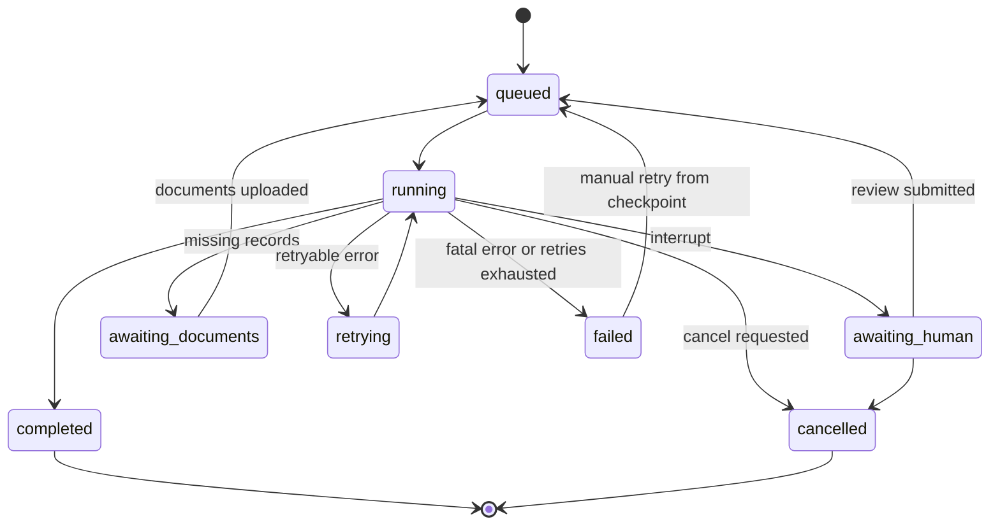

### 6.8 Re-runs and incremental documents

New documents uploaded to a claim after a run has completed create a **new run** with `parent_run_id`. The Intake and Classification agents process only new documents, `organization_agent` merges them into the timeline (`timeline_version + 1`), and downstream agents re-run only for **affected episodes**. Previously validated facts remain validated unless their source pages changed. Summaries and reports are versioned, never overwritten.

---

## 7. Agent Catalog

Each agent is a LangGraph node (or small sub-graph) with a single responsibility, a versioned prompt template in `app/agents/prompts/`, Pydantic input/output schemas and explicit quality gates taken from the "What Good Looks Like" columns of the Persona Walkthrough.

### 7.1 Intake Agent (`intake_agent`) — Stage 1

| Aspect | Detail |
|---|---|
| Requirements | POC-1, PW-1.1, PW-1.2, PW-1.3 |
| Persona counterpart | Medical Records / Summarization Team, Claims Adjuster, Claims Examiner |
| Inputs | Uploaded files (faxes as PDF/TIFF, scanned mail, emails with attachments, PDFs); claim metadata entered at creation; Policy and Coverage information (manual entry or CMS lookup); Utilization Requests (if uploaded) |
| Tools | `ingest_tool`, `ocr_tool`, `packet_splitter_tool`, `dedup_tool`, `date_normalizer_tool`, `cms_connector_tool.lookup_policy` |
| Model | `MODEL_FAST` for packet splitting and baseline extraction; `MODEL_REASONING` for review-context drafting |
| Steps | **(1) Ingest:** convert every file to per-page images plus text (native text via `pypdf`; scanned pages via Gemini vision OCR), store page hashes. **(2) Packet splitting and stream routing:** detect document boundaries inside a multi-document fax (cover sheets, header changes, page "1 of N" resets, provider letterhead changes) and route each split document to a **stream** by document-type metadata tag: `clinical_provider_notes`, `rehab_notes`, `billing`, `legal_admin`, `pharmacy`, `employer_reports`. **(3) Baseline extraction (PW-1.1):** extract claim number, injured worker, DOB, employer, insurer/TPA, date of injury, body part(s), mechanism, assigned adjuster from FROI, the Employer's Accident Report and initial medical documentation; reconcile against claim metadata; compute the **applicable time window** (default: DOI − 2 years for prior-condition history to present; configurable per review goal). **(4) Completeness and priority (PW-1.2):** compare the document inventory against an expected-documents checklist (driven by injury type and events: e.g. surgery mentioned → operative report expected); detect exact and near duplicates; raise **urgency flags** (e.g. surgery scheduled within 7 days, pending UR request deadline, TTD status without recent work-status slip, opioid escalation, red-flag symptoms). **(5) Review context (PW-1.3):** draft the narrowly defined clinical question(s), e.g. "Is the requested L4-L5 fusion consistent with ODG after failed microdiscectomy?", and list the required evidence and applicable guideline(s) and jurisdiction. |
| Outputs | `documents`, `pages`, `document_streams`, claim baseline fields, `document_requests` (missing), `urgent_flags`, `review_contexts` |
| Quality gates | Baseline fields each have a source citation and confidence ≥ 0.95, else HITL-0. Time window present. At least one review goal. Duplicate pages excluded from downstream processing. |

### 7.2 Classification Agent (`classification_agent`) — Stage 2 Step 1

| Aspect | Detail |
|---|---|
| Requirements | POC-2, PW-2.1 |
| Persona counterpart | Medical Records / Summarization Team |
| Inputs | Split documents with page text and first-page image |
| Tools | `classifier_tool` (Gemini Flash, structured output), `code_lookup_tool` (ICD-10/CPT normalization), `date_normalizer_tool` |
| Model | `MODEL_FAST`, fan-out per document (LangGraph `Send` API), concurrency limited by the rate limiter |
| Taxonomy (document type) | ED Visit Record, Orthopedic/Specialist Consultation, Operative Report, IME Report, Physical Therapy Progress Note, Rehab Note, Chiropractic Note, Pain Management Note, Primary Care Note, Post-Op Follow-Up Note, Treatment Plan, Imaging Report (X-ray/MRI/CT), Lab Report, Pharmacy/Prescription Record, FCE Report, Work Status Slip, Utilization Review Request/Decision, Medical Bill (CMS-1500/UB-04), Employer's First Report of Injury (FROI), Employer Accident Report, Legal/Correspondence, Administrative/Fax Cover (noise), Other |
| Tags per document | provider (name, specialty, facility, NPI if found), date(s) of service, encounter id/type, body part(s), treatment(s), imaging, surgery, therapy, work status, ICD-10 and CPT codes, page range |
| Signals used | Headers, layouts, letterheads, form structures (CMS-1500 boxes), section titles ("Operative Findings", "Subjective/Objective/Assessment/Plan"), contextual phrases ("estimated blood loss", "range of motion", "lifting capacity") |
| Outputs | `document_classifications` (type, confidence, tags JSON, rationale), FTS5 index rows |
| Quality gates | Confidence ≥ 0.85, else marked for HITL-1 attention. Every document gets a type (or "Other" with rationale). Billing documents are tagged but excluded from clinical summarization (except dates of service and CPT codes used to corroborate the timeline). |

### 7.3 Organization Agent (`organization_agent`) — Stage 2 Steps 2–3 (automated part)

| Aspect | Detail |
|---|---|
| Requirements | PW-2.2, PW-2.3 (pre-check before NCM) |
| Persona counterpart | Summarization Team, then Nurse Case Manager |
| Tools | `timeline_builder_tool` (deterministic sort), `episode_grouper_tool` (rules plus Gemini Flash for ambiguous cases), `dedup_tool` (near-duplicate via SimHash and embedding similarity), `gap_detector_tool` |
| Logic | Sort documents by date of service, then by encounter. Group into **episodes of care** (e.g. ED episode; ortho consult → surgery → post-op; PT course 12 visits). Remove duplicates (same content faxed twice, the same note in provider and billing packets) and **administrative noise** (fax covers, blank pages, privacy notices). Detect **gaps**: missing referenced documents (e.g. "MRI reviewed" without an MRI report), treatment-interval gaps beyond configurable thresholds (e.g. no visit for more than 30 days during active TTD), PT visit-count mismatches vs prescription, and **date anomalies**. |
| Outputs | `document_index` (ordered), `episodes`, `timeline_gaps`, `dedup_groups`; increments `timeline_version` |
| Quality gates | Every non-noise page belongs to exactly one document and one episode; no unexplained gaps above threshold without a flag. Then HITL-1. |

### 7.4 Clinical Summary Agent (`clinical_summary_agent`) — Stage 3 Step 1

| Aspect | Detail |
|---|---|
| Requirements | POC-3, PW-3.1 |
| Persona counterpart | Nurse Case Manager |
| Inputs | Approved timeline, episodes, page text (by episode), work status slips, FCE, provider restrictions |
| Model | `MODEL_REASONING`, **map-reduce**: summarize each episode (map), then synthesize a longitudinal summary (reduce) |
| Output structure | Executive health summary (≤ 250 words): injury and mechanism; diagnoses (with ICD-10); key tests and results; treatments and response; recovery trajectory; daily functioning; current work status and restrictions; **key narrative changes** (improved, worsened, plateaued) with dates |
| Grounding | Every sentence carries citation markers `[doc:page:line]` that the UI resolves to the source viewer |
| Quality gates | Functional and work limitations explicitly stated; each clinical claim aligned to objective evidence (exam, imaging, FCE) or flagged as subjective-only |

### 7.5 Utilization / Clinical Assessment Agent (`utilization_agent`) — Stage 3 Steps 2–3

| Aspect | Detail |
|---|---|
| Requirements | PW-3.2, PW-3.3 |
| Persona counterpart | Medical Reviewer / Utilization Reviewer, Clinical Reviewers |
| Inputs | Chronology, clinical summary, **provider requests** (MRI, epidural steroid injections, PT extensions, surgery), guideline excerpts from `guideline_retrieval_tool` |
| Outputs | **Draft** utilization assessment per request: medical necessity indicators, appropriateness of treatment, progression of care, **barriers to recovery** (psychosocial, comorbidities, non-compliance, delays), unresolved questions. **Clinical issues list:** inconsistencies (e.g. pain scores vs function), conflicting diagnoses between providers, unexplained treatment changes, missing evidence, and recommended targeted fact-finding (e.g. "request MRI report dated 10/02/2024"). |
| Constraint | Output is labeled **AI draft**; the determination is made only by a human at HITL-4 (PW-7.2) |
| Quality gates | Each necessity indicator cites both the clinical evidence and the guideline criterion; each issue has a severity (low/medium/high) and a suggested action |

### 7.6 Extraction Agent (`extraction_agent`) — Stage 4 Steps 1 and 3

Sub-graph with **parallel specialized extractors** (POC-4 "specialized extraction routines"):

| Sub-extractor | Extracted fields |
|---|---|
| `mmi_extractor` | MMI status (reached / not reached / anticipated), date, declaring provider, impairment rating (% whole person, guide edition), body part, source; conflicting MMI opinions (treating vs IME) |
| `rtw_extractor` | Work status per date (full duty / modified duty / TTD / TPD / off work), restrictions (lift/carry lb limits, sit/stand/walk tolerances, bending, overhead reaching, hours), duration, next re-evaluation, FCE work-capacity classification (sedentary/light/medium/heavy) |
| `treatment_plan_extractor` | Planned treatments (therapy frequency/duration, medications, injections, surgery, DME, referrals), ordering provider, status (requested/approved/completed/discontinued), dates |
| `clinical_fact_extractor` | Injury mechanism, symptoms, diagnoses (ICD-10), imaging (modality, date, findings), procedures (CPT), treatment response, recommendations, causation opinions, medications (name, dose, route, quantity, prescriber, fill dates, status) |
| `turning_point_detector` (Step 3, after HITL-2) | Events that shifted diagnosis, plan, outlook, functioning or **work capacity**, e.g. "MRI 10/02/2024 showed L4-L5 herniation → surgical referral", "FCE 03/2025 → light duty capacity". Each linked to before/after state. |

| Aspect | Detail |
|---|---|
| Requirements | POC-4, PW-4.1, PW-4.3 |
| Model | `MODEL_FAST` for field extraction (per episode); `MODEL_REASONING` for the turning-point detector |
| Output schema (each fact) | `fact_type`, `value` (JSON), `normalized_value`, `effective_date`, `confidence`, `citations[]` (document_id, page_number, line_start, line_end, verbatim quote), `extractor_version` |
| Focus | Functional outcomes: not only what was done but **how the patient responded** and **resulting restrictions**, which drive indemnity and claim financials |
| Quality gates | No fact without at least one citation; dates normalized ISO-8601; units normalized (lb, minutes, %) |

### 7.7 Validation Agent (`validation_agent`) — Stage 4 Step 2 (automated part)

| Aspect | Detail |
|---|---|
| Requirements | PW-4.2 ("Traceability; active discrepancy resolution; zero extrapolation") |
| Tools | `citation_resolver_tool` (fetches cited lines), fuzzy string matcher (RapidFuzz), Gemini Flash **judge** prompt ("Does the quoted text support the value? yes/no/partial + reason") |
| Checks | (1) Citation exists and the quote matches the page text (similarity ≥ 0.9). (2) Value is entailed by the quote (LLM judge). (3) Cross-document consistency (e.g. surgery date in the operative report = post-op note reference = CMS-1500 date of service). (4) Plausibility rules (MMI date ≥ DOI; RTW restrictions consistent with FCE). |
| Outputs | `validation_status` per fact: `auto_verified`, `needs_review`, `rejected` (ungrounded), plus `discrepancies` |
| Behaviour | Ungrounded facts are **never** passed downstream. `needs_review` facts and all milestone facts go to HITL-2. |

### 7.8 Guideline Agent (`guideline_agent`) — Stage 5

| Aspect | Detail |
|---|---|
| Requirements | POC-5, PW-5.1, PW-5.2 |
| Persona counterpart | Medical Reviewer / Utilization Reviewer, Clinical Reviewer |
| Inputs | Validated facts and milestones, chronology, jurisdiction (from claim, e.g. PA), review context |
| Tools | `guideline_retrieval_tool` (hybrid FTS5 + vector search over `guideline_rules` filtered by jurisdiction, body part, diagnosis and procedure), `duration_calculator_tool` |
| Step 1 (PW-5.1) | Assemble the **case-fact narrative arc**: injury details → symptom progression → objective findings → treatment plans → clinical responses → current work status, in structured scannable form with audit-ready citations |
| Step 2 (PW-5.2) | Identify **clinically significant milestones** and map cause → effect on the claim (diagnosis, treatment, prognosis, function, work status). Link each to work capacity. |
| Deviation analysis (POC-5) | For each treatment/request: **off-guideline therapy request** (procedure not recommended for the diagnosis or lacking prerequisites such as conservative care first); **excessive duration** (e.g. PT visits beyond guideline visit count; opioid use beyond the recommended period); **stalled recovery pattern** (no functional improvement across N visits, pain scores flat, TTD beyond expected disability duration); **unusual escalation** (rapid move to invasive procedures) |
| Outputs | `guideline_findings` (finding_type, severity, treatment ref, guideline rule ref and excerpt, evidence citations, recommendation), `milestone_impacts` |
| Constraint | Guideline content is provided by the licensed source loaded into `guideline_rules` (§19). The agent must cite a rule id or say "no applicable guideline found"; it may not rely on model memory for guideline criteria. |

### 7.9 Chronology Agent (`chronology_agent`) and Report Agent (`report_agent`) — Stage 6

| Aspect | Chronology Agent | Report Agent |
|---|---|---|
| Requirements | POC-6, PW-6.1 | POC-6, PW-6.2, POC-OUT |
| Inputs | Validated facts, milestones, turning points, episodes | Chronology, milestones, guideline findings, clinical summary, review context |
| Logic | Deterministic assembly of `chronology_events` (date, provider, event type, description, key findings, work status, citation) with an LLM pass (Flash) only for concise event descriptions | `MODEL_REASONING` generates the **clinical narrative** (injury → diagnosis → treatment → response → function → current status) and the **one-page actionable summary**; templating via `report_template_tool` |
| Outputs | Structured medical chronology (table) | (1) **One-page actionable summary**; (2) **MMI status report**; (3) **Structured medical chronology** export; (4) **Case-progress summary**; all exportable to PDF/DOCX/JSON |
| Quality gates | Flawless sequential flow; page-level traceability on every row | No unverified assumptions (every sentence cites validated facts); administrative and clinical noise filtered; focus on approval, cost exposure and occupational recovery drivers; one-page limit enforced (≤ ~600 words, rendered page count checked) |

**One-page summary template sections:** Claim header (claim #, claimant, DOI, employer, TPA, adjuster) · Review question · Injury and diagnosis · Treatment to date (key milestones) · Current clinical status · Work status and restrictions (RTW) · MMI status · Guideline flags · Open issues / missing records · Recommended next actions · Evidence index.

### 7.10 Decision Support Agent, Routing Agent and Record Keeping — Stage 7

| Aspect | `decision_support_agent` | `routing_agent` | `record_keeping` node |
|---|---|---|---|
| Requirements | POC-7, PW-7.1 | POC-OUT ("direct complex or exceptional cases"), PR-4 | PW-7.3 |
| Function | Builds the **decision workspace**: AI-highlighted flags (MMI status, RTW limits, guideline deviations, urgent items), each with a recommended action and **one-click approve/reject**; drafts a recommendation on treatment, disability and claim trajectory with evidence links; never auto-decides | Computes `risk_score` and `complexity` from rules (surgery, conflicting MMI opinions, litigation flag, TTD duration, guideline deviations count, opioid use, open clinical issues, reserve impact) and an LLM rationale; assigns reviewers (examiner, clinical reviewer, NCM, supervisor) and due dates | After HITL-4/5, compiles the **decision record**: rationale, evidence citations, outstanding questions, next steps, follow-ups (diary dates), communications; seals the record (hash) and logs to CMS via `cms_connector_tool` |
| Outputs | `decision_drafts`, `flags` | `assignments`, `notifications`, escalation entries | `decisions` (final), `follow_ups`, `cms_sync_log`, `audit_log` |

---

## 8. Tools Layer

Tools are plain Python callables registered in a **Tool Registry** with a name, version, JSON schema of inputs/outputs, timeout, retry policy and permission scope. Agents invoke tools only through `ctx.tools.call(name, **args)`, which validates the arguments, enforces the timeout, logs to `tool_calls` and raises typed errors.

| Tool | Purpose | Implementation | Deterministic? | Used by |
|---|---|---|---|---|
| `ingest_tool` | Accept file, detect MIME, virus-scan, store encrypted, compute SHA-256 | `python-magic`, ClamAV (optional), `cryptography` (Fernet/AES-GCM) | Yes | Intake |
| `email_parser_tool` | Extract body and attachments from `.eml`/`.msg` | `email` stdlib, `extract-msg` | Yes | Intake |
| `pdf_render_tool` | Split PDF/TIFF into pages; render PNG at 200 DPI; extract native text with line coordinates | `pypdf`, `pdfplumber`, `pypdfium2`, Pillow | Yes | Intake |
| `ocr_tool` | Text plus line numbers for scanned pages | Gemini vision (`MODEL_FAST`) returning JSON lines with bounding boxes; optional local Tesseract fallback | No (LLM) | Intake |
| `packet_splitter_tool` | Detect document boundaries in a multi-document packet and assign a stream tag | Heuristics (page-count resets, header change, blank separators) plus Gemini Flash boundary check | Hybrid | Intake |
| `dedup_tool` | Exact (SHA-256 of normalized text) and near duplicates (SimHash, embedding cosine ≥ 0.97) | Python, `sqlite-vec` | Yes | Intake, Organization |
| `classifier_tool` | Document type and tags | Gemini Flash with structured output plus few-shot examples | No | Classification |
| `date_normalizer_tool` | Parse and normalize dates; resolve relative dates ("POD 14") | `dateparser`, custom rules | Yes | All |
| `code_lookup_tool` | Validate/normalize ICD-10-CM and CPT/HCPCS codes, map descriptions | Local SQLite code tables (ICD-10-CM is public; CPT requires AMA license, see §19) | Yes | Classification, Extraction |
| `timeline_builder_tool` | Sort and group documents and episodes | Python | Yes | Organization, Chronology |
| `gap_detector_tool` | Detect missing referenced documents and interval gaps | Rules plus Flash check for "referenced but missing" | Hybrid | Organization |
| `embedding_tool` | Create embeddings for page chunks and guideline rules | Gemini embeddings → `sqlite-vec` | No | Indexing, Guideline |
| `search_tool` | Hybrid keyword (FTS5 BM25) plus vector search with reciprocal-rank fusion | SQL | Yes | Agents, UI search |
| `guideline_retrieval_tool` | Retrieve applicable guideline rules by jurisdiction, body part, diagnosis, procedure | `search_tool` over `guideline_rules` plus metadata filters | Yes | Utilization, Guideline |
| `duration_calculator_tool` | Compare actual vs guideline durations and visit counts | Python | Yes | Guideline |
| `citation_resolver_tool` | Resolve `[doc:page:line]` to text and page image coordinates | SQL on `page_lines` | Yes | Validation, UI |
| `report_template_tool` | Render reports to HTML → PDF and DOCX | Jinja2, WeasyPrint (PDF), `python-docx` (DOCX) | Yes | Report |
| `cms_connector_tool` | Look up policy and coverage; post decision record, notes and diary entries | Interface with `MockCMSConnector` (writes `cms_sync_log`) for v1; REST/SOAP adapter for the real CMS later | Yes | Intake, Record Keeping |
| `notification_tool` | In-app notifications and optional email for assignments, SLA breaches | SQLite `notifications`, SMTP | Yes | Routing |

### 8.1 Tool execution flow

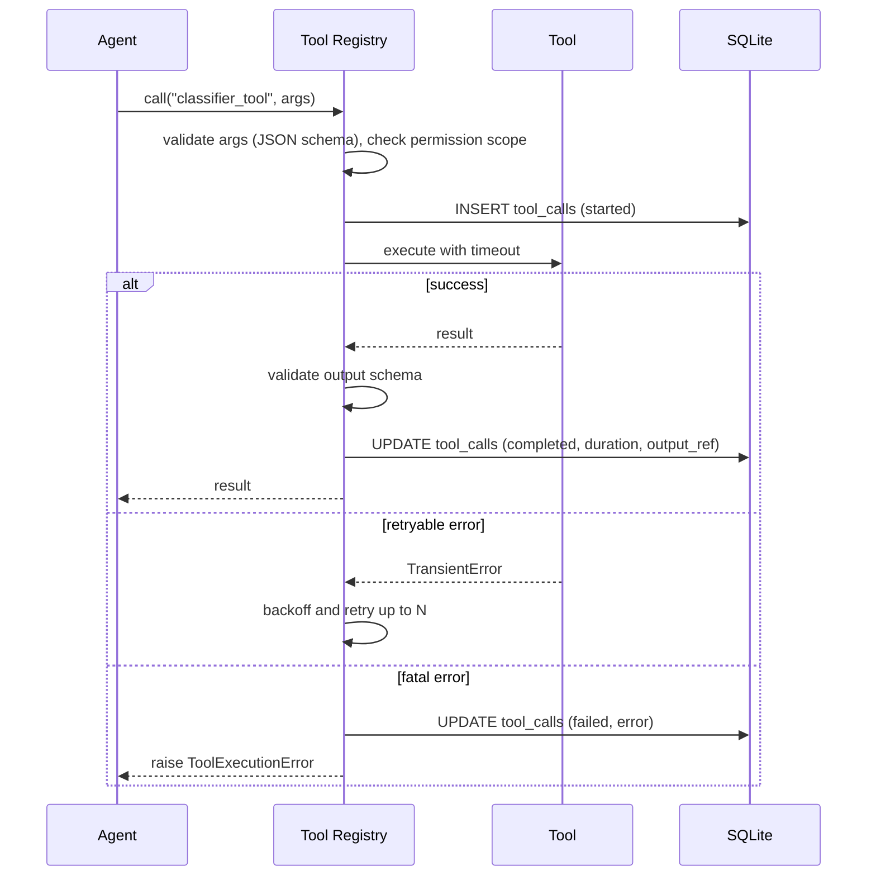

### 8.2 Dependency graph between agents and tools

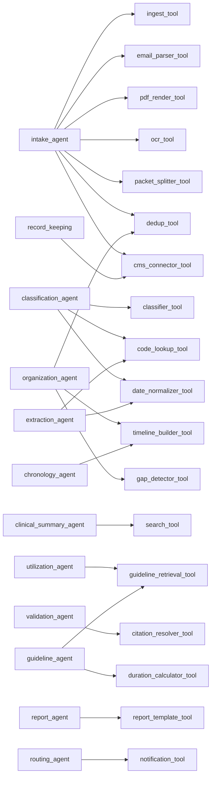

---

## 9. End-to-End Workflow: Stage by Stage

For each stage this section lists the persona, inputs, agent actions, human actions, outputs and acceptance criteria. Acceptance criteria are taken directly from the "What Good Looks Like" columns of the source documents.

### 9.1 Stage 1 — Medical Record Intake

**Personas:** Medical Records / Summarization Team → Claims Examiner / Adjuster
**Inputs:** FROI, Employer's Accident Report, initial medical documentation, policy and coverage information, the medical-record package (faxes, mail scans, emails), utilization requests, evidence-based treatment guidelines (for context).

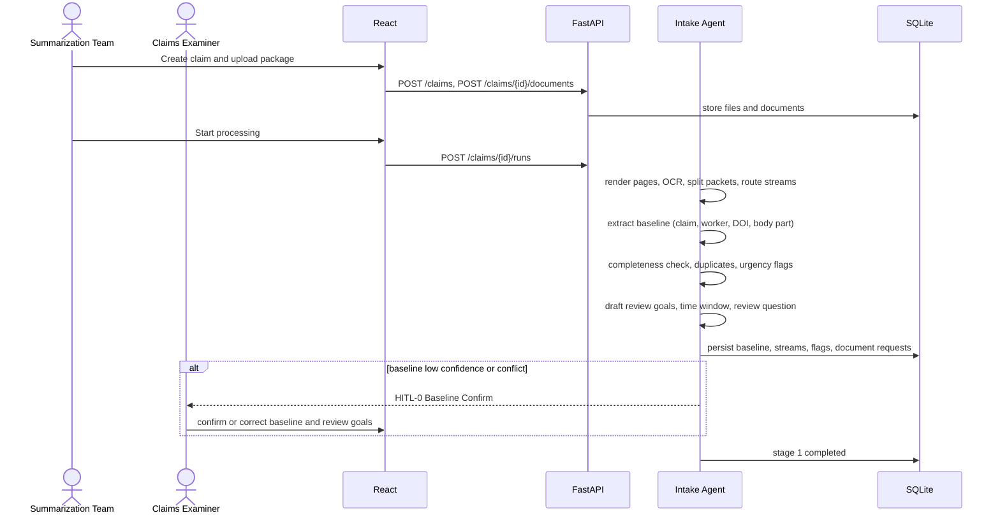

| Step | Agent action | Human action | Output | Acceptance criteria |
|---|---|---|---|---|
| 1.1 | Extract claim number, injured worker, DOI, body part; propose review goals and time window | Confirm/edit (HITL-0 if needed) | Locked claim baseline, review goals | 100% accuracy on baseline data; flawless time-window management; clear, actionable review goals |
| 1.2 | Inventory documents; flag missing, duplicates, urgent items | Adjuster reviews priority list; sends document requests | `document_requests`, `urgent_flags`, duplicates excluded | Zero file clutter; proactive document chasing; instant identification of urgency |
| 1.3 | Draft review question(s), required evidence, applicable guidelines and state rules | Examiner refines question | `review_contexts` | Precise, narrowly defined clinical question; required evidence identified; aligned with guidelines and state rules; efficient for summarization teams |
| POC-1 | Automated ingestion; packet identification; routing into Provider Notes / Rehab / Billing streams by metadata tags | — | `document_streams` | Instant ingestion; correct stream routing |

### 9.2 Stage 2 — Document Classification and Processing

**Personas:** Medical Records / Summarization Team → Nurse Case Manager
**Inputs:** bulk faxes or PDF uploads with hundreds of mixed pages; records spanning years and specialties (primary care, orthopedics, PT, chiropractic, pain management).

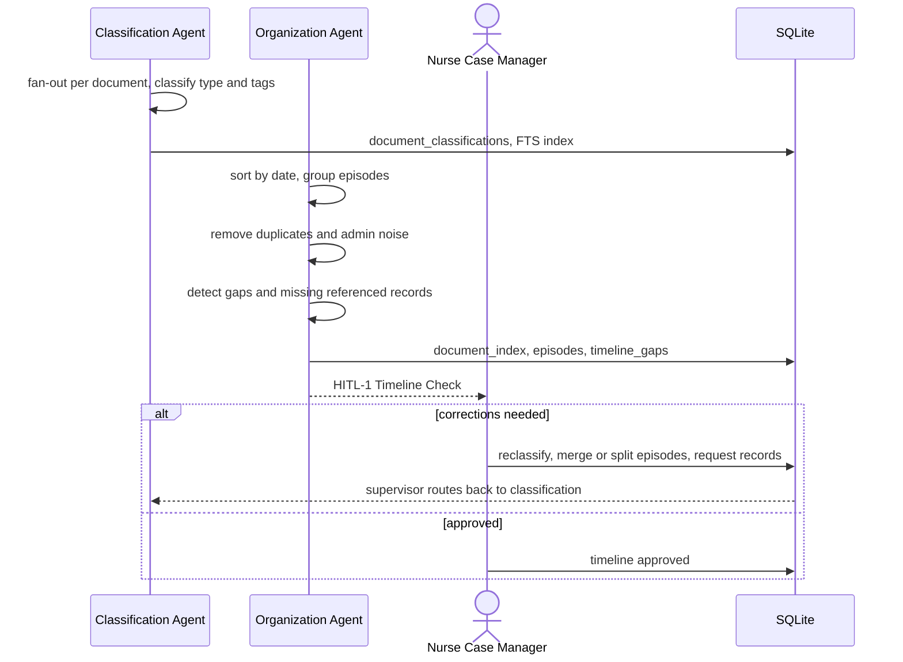

| Step | Agent action | Human action | Output | Acceptance criteria |
|---|---|---|---|---|
| 2.1 | Classify by provider, date, type, encounter, body part, treatment, imaging, surgery, therapy, work status; auto-sort and index Operative Reports, IME Reports, Rehab Notes, Treatment Plans | Summarization Team can correct tags | Classified, indexed, searchable documents | Flawless granular tagging; noise separated from value; instant searchability |
| 2.2 | Chronological order, episode grouping, deduplication, noise removal | — | `document_index`, `episodes` | Flawless chronological timeline; logical episode grouping; zero administrative noise and duplicates |
| 2.3 | Gap detection, provider-note cross-validation | **NCM verifies completeness and sequence (HITL-1)** | Approved timeline | Zero gaps in timeline; chronological integrity; cross-validation of provider notes |

### 9.3 Stage 3 — Medical Record Review and Clinical Understanding

**Personas:** Summarization Team → Nurse Case Manager; Medical Reviewer / Utilization Reviewer; Clinical Reviewers
**Inputs:** physician exam notes, progress reports, work status slips, FCEs, provider restrictions, organized chronology, ODG/ACOEM, provider requests (MRI, ESI, PT extensions, surgery).

| Step | Agent action | Human action | Output | Acceptance criteria |
|---|---|---|---|---|
| 3.1 | `clinical_summary_agent`: episode map-reduce summary; executive health summary highlighting key narrative changes | NCM reads (formal approval in HITL-3) | `summaries` (type `clinical`) | Comprehensive clinical summary; clear functional and work limitations; objective evidence alignment |
| 3.2 | `utilization_agent`: draft necessity/appropriateness/progression assessment per request; barriers | UR reviewer reviews draft (determination at HITL-4) | `utilization_assessments` | Objective medical necessity; clear identification of barriers; actionable clinical outcomes |
| 3.3 | `utilization_agent`: surface inconsistencies, conflicting diagnoses, unexplained changes, missing evidence | Clinical reviewer triages issues | `clinical_issues` | Discrepancies spotted early; targeted fact-finding; defensible decisions set up |

### 9.4 Stage 4 — Identification of Key Facts and Milestones

**Personas:** Summarization Team → Clinical Reviewer → Nurse Case Manager
**Inputs:** organized timeline and source records; previous medical review notes; draft extraction report; key diagnostic and surgical reports.

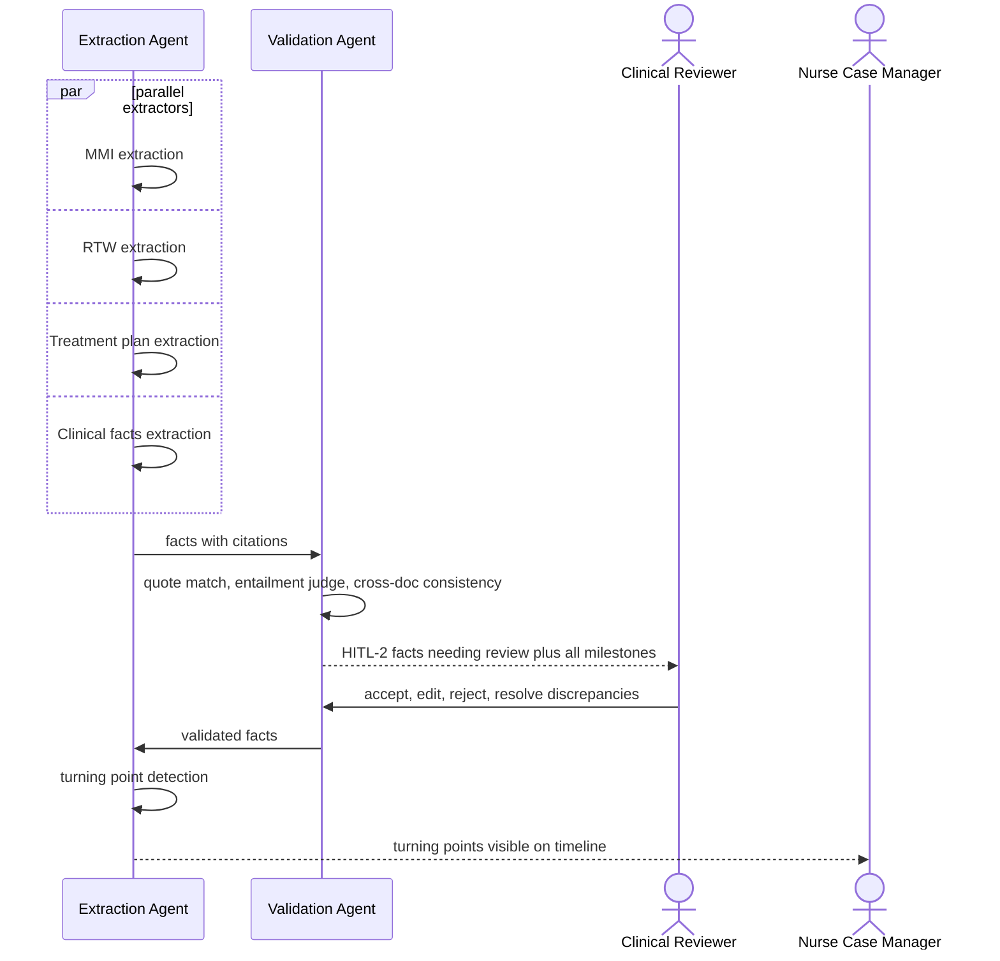

| Step | Agent action | Human action | Output | Acceptance criteria |
|---|---|---|---|---|
| 4.1 | Extract mechanism, symptoms, diagnoses, imaging, procedures, treatment, response, restrictions, work status, recommendations; MMI/RTW/treatment-plan routines | — | `extracted_facts`, `citations` | Structured, standardized extraction; focus on functional outcomes |
| 4.2 | Automated grounding and consistency checks | **Clinical Reviewer validates against source (HITL-2)** | Validated facts, resolved `discrepancies` | Traceability (page-and-line citations); active discrepancy resolution; zero extrapolation |
| 4.3 | Turning-point detection | NCM reviews highlighted events | `milestones` (turning points), work-capacity trajectory | True turning points pinpointed; work-capacity trajectory tracked; treatment response connected to outlook |

### 9.5 Stage 5 — Treatment and Guideline Review

**Persona:** Medical Reviewer / Utilization Reviewer; Clinical Reviewer
**Inputs:** validated chronological packet; extraction and milestone notes; diagnostic reports, surgical notes, FCEs; guideline store.

| Step | Agent action | Human action | Output | Acceptance criteria |
|---|---|---|---|---|
| 5.1 | Assemble narrative arc: injury details, symptom progression, objective findings, plans, responses, current work status | Reviewer reads | `case_fact_sheet` (structured, cited) | Complete clinical narrative arc; structured, scannable formatting; audit-ready citations |
| 5.2 | Identify clinically significant milestones; map cause → effect; link to work capacity | Reviewer confirms | `milestone_impacts` | Clear cause-and-effect mapping; direct link to work capacity |
| POC-5 | Cross-reference treatments with ODG/ACOEM; flag off-guideline requests, excessive duration, stalled recovery | Reviewer accepts/dismisses flags (at HITL-4) | `guideline_findings` | Every flag cites guideline rule and evidence |

### 9.6 Stage 6 — Chronology and Summary Preparation

**Personas:** Summarization Team; Medical Records / Summarization Team; Nurse Case Manager
**Inputs:** validated deduplicated records; extracted facts and milestones; built chronology; claim context.

| Step | Agent action | Human action | Output | Acceptance criteria |
|---|---|---|---|---|
| 6.1 | `chronology_agent` builds the structured chronology | Summarization Team may edit rows | `chronology_events` | Flawless sequential flow; comprehensive data integration; page-level traceability |
| 6.2 | `report_agent` writes the narrative and one-page summary, MMI status report, case-progress summary | — | `reports` (draft) | Defensible clarity without unverified assumptions or bias; noise filtered; focus on approval, cost exposure, occupational recovery |
| 6.3 | — | **NCM reviews and contextualizes (HITL-3)** | Approved `summaries`/`reports` (versioned) | Summary answers the claim question and highlights evidence for the next decision |

### 9.7 Stage 7 — User Review and Action

**Personas:** Claims Examiner; Medical Reviewer / Utilization Reviewer; Claims Supervisor / Claims Manager
**Inputs:** clinical summary, claim file, guideline findings, work status, prior decisions, treatment requests.

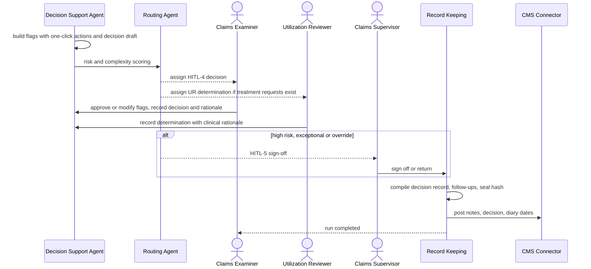

| Step | Agent action | Human action | Output | Acceptance criteria |
|---|---|---|---|---|
| 7.1 | Decision draft and flags with one-click approvals | **Examiner decides (HITL-4)** | `decisions` (treatment, disability, claim trajectory) | Decision supported by documented evidence and appropriate to claim context |
| 7.2 | Utilization draft with criteria mapping | **UR determination (HITL-4 UR)** | `ur_determinations` | Determination clearly connects evidence and criteria to conclusion |
| 7.3 | Compile decision record; CMS logging; notifications | **Supervisor sign-off (HITL-5) when required** | Sealed decision record, `follow_ups`, `cms_sync_log` | Clear, defensible, traceable, actionable; another reviewer can see how the decision was reached |
| POC-7 | Streamlined workflow so humans spend time on action and strategy rather than reading | — | Review time metrics | Reduced human review time (§17) |

---

## 10. Data Pipeline

### 10.1 Pipeline overview

```mermaid
flowchart LR
  rawFiles[Raw Uploads - PDF TIFF IMG EML DOCX] --> scan[Validate, MIME check, virus scan, SHA-256]
  scan --> store[Encrypted File Store]
  store --> render[Page Render PNG and Native Text]
  render --> ocrStep[OCR for scanned pages - Gemini Vision]
  ocrStep --> lines[page_lines with line numbers and bbox]
  render --> lines
  lines --> split[Packet Split and Stream Routing]
  split --> dedupStep[Exact and Near Dedup]
  dedupStep --> classifyStep[Classification and Tagging]
  classifyStep --> indexStep[FTS5 Index and Chunk Embeddings]
  classifyStep --> organizeStep[Timeline, Episodes, Gaps]
  organizeStep --> extractStep[Fact Extraction with Citations]
  extractStep --> validateStep[Grounding Validation]
  validateStep --> factsStore[(extracted_facts, milestones, citations)]
  factsStore --> guidelineStep[Guideline Matching]
  factsStore --> chronoStep[Chronology Build]
  guidelineStep --> reportStep[Reports and One-Page Summary]
  chronoStep --> reportStep
  reportStep --> decisionStep[HITL Decisions]
  decisionStep --> cmsStep[CMS Log and Sealed Decision Record]
```

### 10.2 Data artifacts per stage

| Stage | Artifact | Storage | Retention / versioning |
|---|---|---|---|
| Upload | Original file (encrypted) | `data/files/{claim_id}/original/{document_id}.bin` | Immutable; retained per records policy |
| Ingest | Page images (PNG), page text, line coordinates | `data/files/{claim_id}/pages/`, `pages`, `page_lines` | Immutable |
| Index | FTS5 rows, 1,000-token chunks with 150-token overlap, embeddings | `pages_fts`, `page_chunks`, `page_chunk_vectors` | Rebuildable |
| Classification | Type, tags, confidence | `document_classifications` (versioned by `version` column) | New version on human edit |
| Organization | Ordered index, episodes, gaps | `document_index`, `episodes`, `timeline_gaps` | `timeline_version` |
| Extraction | Facts, citations, milestones | `extracted_facts`, `citations`, `milestones` | Edits create new fact versions; original kept |
| Guideline | Findings | `guideline_findings` | Per run |
| Output | Summaries, chronology, reports | `summaries`, `chronology_events`, `reports` plus files | Versioned; approved versions locked |
| Action | Reviews, decisions, follow-ups | `reviews`, `decisions`, `follow_ups` | Immutable after seal |
| Telemetry | Runs, steps, tool and LLM calls, audit | `agent_runs`, `agent_steps`, `tool_calls`, `llm_calls`, `audit_log` | Append-only |

### 10.3 Chunking and citation strategy

- Text is stored **per page, per line** (`page_lines.line_number`), so citations are exact, and the UI highlights bounding boxes on the rendered page.
- LLM prompts include page/line markers, e.g. `<<D12|P3|L14>> Patient reports pain 6/10`, so the model can cite precisely. The output schema requires `citations` arrays.
- Chunks for semantic search never cross document boundaries.

### 10.4 Integrations

| Integration | Direction | v1 implementation | Future |
|---|---|---|---|
| Google Gemini API (AI Studio) | Outbound HTTPS | `google-genai` SDK, API key | Vertex AI (enterprise data controls, regional endpoints) |
| Claims Management System (CMS) | Bidirectional | `MockCMSConnector` (SQLite `cms_sync_log`), CSV export | REST/SOAP adapter (e.g. Guidewire ClaimCenter, Origami); webhook for new documents |
| Fax / email intake | Inbound | Manual upload | Fax server drop folder watcher; IMAP/Graph API mailbox poller |
| Guideline content (ODG, ACOEM, state formularies) | Inbound | Admin CSV/JSON import into `guideline_rules` | Licensed vendor API |
| Code sets (ICD-10-CM, CPT/HCPCS) | Inbound | Admin import into code tables | Scheduled annual updates |
| Identity provider | Inbound | Local users (bcrypt/argon2) plus JWT | OIDC/SAML SSO (Azure AD/Okta) |

---

## 11. Database Schema (SQLite)

### 11.1 Entity-relationship diagram (core)

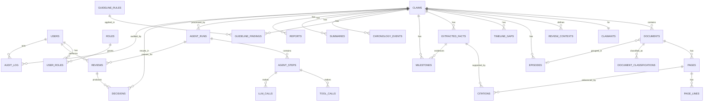

### 11.2 Table definitions

Conventions: primary keys are `TEXT` UUIDv7 (time-sortable); timestamps are `TEXT` ISO-8601 UTC; JSON columns are `TEXT` with `CHECK (json_valid(col))`; every table has `created_at`, and mutable tables have `updated_at` and `version`.

#### Identity and access

| Table | Key columns |
|---|---|
| `users` | `id`, `email` UNIQUE, `full_name`, `password_hash` (argon2), `is_active`, `mfa_secret_enc`, `last_login_at` |
| `roles` | `id`, `key` UNIQUE (`summarization_team`, `claims_examiner`, `nurse_case_manager`, `clinical_reviewer`, `claims_supervisor`, `attorney`, `admin`), `description` |
| `permissions` / `role_permissions` | `permission_key`, `role_id` |
| `user_roles` | `user_id`, `role_id`, `granted_by`, `granted_at` |
| `refresh_tokens` | `id`, `user_id`, `token_hash`, `expires_at`, `revoked_at` |

#### Claims and documents

| Table | Key columns |
|---|---|
| `claimants` | `id`, `full_name_enc`, `dob_enc`, `ssn_last4_enc`, `contact_enc` (encrypted PHI fields) |
| `claims` | `id`, `claim_number` UNIQUE (e.g. `WC-2024-PA-087341`), `claimant_id`, `employer_name`, `employer_contact`, `insurer`, `tpa`, `date_of_injury`, `jurisdiction_state`, `body_parts` JSON, `mechanism_of_injury`, `assigned_adjuster_id`, `assigned_ncm_id`, `status` (`open`, `in_review`, `decided`, `closed`), `baseline_locked`, `time_window_start`, `time_window_end`, `risk_score`, `complexity`, `litigated` |
| `review_contexts` | `id`, `claim_id`, `review_goals` JSON, `clinical_question`, `required_evidence` JSON, `applicable_guidelines` JSON, `state_rules` JSON, `created_by`, `approved_by` |
| `documents` | `id`, `claim_id`, `source_channel` (`fax`, `mail`, `email`, `upload`, `cms`), `original_filename`, `mime_type`, `sha256`, `storage_path`, `page_count`, `stream` (`clinical_provider_notes`, `rehab_notes`, `billing`, `pharmacy`, `employer_reports`, `legal_admin`), `parent_document_id` (for split packets), `page_start`, `page_end`, `status` (`received`, `processed`, `duplicate`, `noise`, `failed`), `received_at`, `uploaded_by` |
| `pages` | `id`, `document_id`, `page_number`, `image_path`, `text`, `text_source` (`native`, `ocr`), `ocr_confidence`, `text_hash`, `simhash`, `is_blank`, `is_duplicate_of` |
| `page_lines` | `id`, `page_id`, `line_number`, `text`, `bbox` JSON |
| `pages_fts` | FTS5 virtual table (`text`, `page_id` UNINDEXED, `claim_id` UNINDEXED) |
| `page_chunks` / `page_chunk_vectors` | Chunk text with page/line range; `sqlite-vec` `vec0` table (`embedding float[768]`) |
| `document_classifications` | `id`, `document_id`, `doc_type`, `confidence`, `provider_name`, `provider_specialty`, `facility`, `npi`, `service_date_start`, `service_date_end`, `encounter_type`, `body_parts` JSON, `tags` JSON (treatment, imaging, surgery, therapy, work_status), `icd10_codes` JSON, `cpt_codes` JSON, `rationale`, `classified_by` (`agent`/user id), `version`, `is_current` |
| `document_requests` | `id`, `claim_id`, `description`, `reason`, `requested_from`, `status` (`open`, `sent`, `received`, `cancelled`), `due_date` |
| `dedup_groups` | `id`, `claim_id`, `canonical_document_id`, `member_document_ids` JSON, `method` (`exact`, `near`), `similarity` |

#### Organization and clinical content

| Table | Key columns |
|---|---|
| `providers` | `id`, `name`, `specialty`, `facility`, `npi`, `phone`, `fax`, `email`, `address` (deduplicated from classifications; supports NCM provider coordination, PR-2) |
| `provider_contacts` | `id`, `claim_id`, `provider_id`, `contact_type` (`call`, `fax`, `email`, `meeting`), `purpose` (records request, treatment coordination, RTW discussion), `notes`, `contacted_by`, `contacted_at`, `follow_up_date` |
| `rtw_status_history` | `id`, `claim_id`, `effective_date`, `work_status` (`full_duty`, `modified_duty`, `ttd`, `tpd`, `off_work`), `restrictions` JSON, `source_fact_id`, `expected_next_change`, `employer_accommodation` (supports RTW progress monitoring, PR-2) |
| `episodes` | `id`, `claim_id`, `label` (e.g. "Lumbar surgery episode"), `start_date`, `end_date`, `provider_ids` JSON, `timeline_version` |
| `document_index` | `claim_id`, `document_id`, `episode_id`, `sort_order`, `timeline_version` |
| `timeline_gaps` | `id`, `claim_id`, `gap_type` (`missing_referenced_record`, `treatment_interval`, `visit_count_mismatch`, `date_anomaly`), `description`, `start_date`, `end_date`, `severity`, `status` (`open`, `explained`, `requested`, `resolved`), `resolution_note` |
| `extracted_facts` | `id`, `claim_id`, `run_id`, `fact_type` (`mechanism`, `symptom`, `diagnosis`, `imaging`, `procedure`, `treatment`, `response`, `restriction`, `work_status`, `recommendation`, `medication`, `mmi`, `rtw`, `treatment_plan`, `causation`, `impairment_rating`), `value` JSON, `normalized_value` JSON, `effective_date`, `confidence`, `extractor` + `extractor_version`, `validation_status` (`pending`, `auto_verified`, `needs_review`, `validated`, `edited`, `rejected`), `validated_by`, `validated_at`, `supersedes_fact_id` |
| `citations` | `id`, `fact_id` (or `owner_type` + `owner_id` for summary sentences and findings), `document_id`, `page_id`, `line_start`, `line_end`, `quote`, `match_score` |
| `discrepancies` | `id`, `claim_id`, `fact_ids` JSON, `description`, `status`, `resolution`, `resolved_by` |
| `milestones` | `id`, `claim_id`, `milestone_type` (`mmi`, `rtw`, `surgery`, `diagnosis_change`, `fce`, `ime`, `treatment_change`, `work_capacity_change`), `milestone_date`, `description`, `before_state` JSON, `after_state` JSON, `impact` (diagnosis/treatment/prognosis/function/work_status), `is_turning_point`, `fact_ids` JSON, `status` |
| `clinical_issues` | `id`, `claim_id`, `issue_type` (`inconsistency`, `conflicting_diagnosis`, `unexplained_change`, `missing_evidence`, `barrier`), `description`, `severity`, `suggested_action`, `status`, `owner_id` |
| `utilization_assessments` | `id`, `claim_id`, `request_description`, `request_type` (`mri`, `esi`, `pt_extension`, `surgery`, `medication`, `other`), `requesting_provider`, `necessity_indicators` JSON, `guideline_rule_ids` JSON, `ai_recommendation`, `status` |

#### Guidelines

| Table | Key columns |
|---|---|
| `guideline_sources` | `id`, `name` (ODG, ACOEM, state formulary, custom), `edition`, `jurisdiction`, `license_ref`, `effective_from`, `effective_to` |
| `guideline_rules` | `id`, `source_id`, `rule_code`, `title`, `body_part`, `diagnosis_codes` JSON, `procedure_codes` JSON, `criteria_text`, `max_visits`, `max_duration_days`, `prerequisites` JSON, `recommendation` (`recommended`, `not_recommended`, `conditional`) |
| `guideline_rules_fts` / `guideline_rule_vectors` | Search indexes |
| `guideline_findings` | `id`, `claim_id`, `run_id`, `finding_type` (`off_guideline_request`, `excessive_duration`, `stalled_recovery`, `unusual_escalation`, `compliant`), `severity`, `treatment_ref` (fact id), `guideline_rule_id`, `explanation`, `recommendation`, `status` (`open`, `accepted`, `dismissed`), `reviewed_by`, `review_reason` |

#### Outputs and decisions

| Table | Key columns |
|---|---|
| `chronology_events` | `id`, `claim_id`, `event_date`, `provider`, `event_type`, `description`, `key_findings`, `work_status`, `episode_id`, `fact_ids` JSON, `sort_order`, `version` |
| `summaries` | `id`, `claim_id`, `summary_type` (`clinical`, `executive`, `narrative`, `one_page`), `content_md`, `content_json`, `version`, `status` (`draft`, `in_review`, `approved`, `superseded`), `generated_by_run_id`, `approved_by`, `approved_at` |
| `reports` | `id`, `claim_id`, `report_type` (`one_page_summary`, `mmi_status`, `medical_chronology`, `case_progress`), `format` (`pdf`, `docx`, `json`), `file_path`, `summary_id`, `version`, `status` |
| `reviews` | `id`, `run_id`, `claim_id`, `checkpoint` (`HITL-0`…`HITL-5`), `assigned_role`, `assigned_user_id`, `payload` JSON, `response` JSON, `status` (`pending`, `in_progress`, `submitted`, `expired`, `reassigned`), `due_at`, `submitted_by`, `submitted_at`, `reason` |
| `flags` | `id`, `claim_id`, `flag_type` (`mmi_status`, `rtw_limit`, `guideline_deviation`, `urgent`, `gap`, `clinical_issue`), `ref_type`, `ref_id`, `ai_recommendation`, `human_action` (`approved`, `rejected`, `modified`), `acted_by`, `acted_at`, `reason` |
| `decisions` | `id`, `claim_id`, `review_id`, `decision_type` (`treatment_authorization`, `disability_status`, `claim_trajectory`, `reserve_change`, `referral`, `escalation`), `outcome`, `rationale`, `evidence_refs` JSON, `outstanding_questions` JSON, `next_steps` JSON, `decided_by`, `decided_at`, `signed_off_by`, `signed_off_at`, `record_hash`, `status` (`draft`, `final`, `sealed`) |
| `ur_determinations` | `id`, `claim_id`, `utilization_assessment_id`, `determination` (`certified`, `modified`, `non_certified`, `pended`), `clinical_rationale`, `criteria_refs` JSON, `reviewer_id`, `determined_at` |
| `follow_ups` | `id`, `claim_id`, `decision_id`, `action`, `owner_id`, `due_date`, `status` |
| `assignments` / `notifications` | Work queue items and user notifications |
| `cms_sync_log` | `id`, `claim_id`, `entity_type`, `entity_id`, `direction`, `payload` JSON, `status`, `external_ref`, `attempts`, `last_error` |

#### Orchestration, telemetry and audit

| Table | Key columns |
|---|---|
| `jobs` | `id`, `job_type` (`start_run`, `resume_run`, `export_report`, `reindex`), `payload` JSON, `status` (`queued`, `claimed`, `done`, `failed`), `attempts`, `available_at`, `claimed_by`, `claimed_at`, `last_error` |
| `agent_runs` | `id`, `claim_id`, `parent_run_id`, `graph_version`, `status` (see §6.7), `current_stage`, `current_node`, `started_by`, `started_at`, `completed_at`, `error`, `total_tokens`, `total_cost_usd` |
| `agent_steps` | `id`, `run_id`, `node_name`, `stage`, `attempt`, `status`, `input_ref` JSON, `output_ref` JSON, `started_at`, `ended_at`, `duration_ms`, `error_type`, `error_message`, `correlation_id` |
| `tool_calls` | `id`, `step_id`, `tool_name`, `tool_version`, `args_redacted` JSON, `result_ref`, `status`, `duration_ms`, `error` |
| `llm_calls` | `id`, `step_id`, `provider` (`gemini`), `model`, `prompt_template`, `prompt_version`, `input_tokens`, `output_tokens`, `latency_ms`, `cost_usd`, `finish_reason`, `safety_ratings` JSON, `request_enc`, `response_enc`, `status`, `retry_count` |
| `run_events` | `id` (autoincrement, used as SSE `Last-Event-ID`), `run_id`, `event_type`, `data` JSON, `created_at` |
| `prompt_templates` | `id`, `name`, `version`, `template`, `output_schema` JSON, `model_tier`, `is_active`, `created_by` |
| `audit_log` | `id` autoincrement, `ts`, `actor_type` (`user`, `agent`, `system`), `actor_id`, `action` (e.g. `document.upload`, `fact.validate`, `decision.signoff`, `phi.view`, `report.export`), `entity_type`, `entity_id`, `claim_id`, `before` JSON, `after` JSON, `ip`, `user_agent`, `correlation_id`, `prev_hash`, `hash` |

### 11.3 Example DDL (selected)

```sql
PRAGMA foreign_keys = ON;

CREATE TABLE extracted_facts (
  id                TEXT PRIMARY KEY,
  claim_id          TEXT NOT NULL REFERENCES claims(id),
  run_id            TEXT REFERENCES agent_runs(id),
  fact_type         TEXT NOT NULL,
  value             TEXT NOT NULL CHECK (json_valid(value)),
  normalized_value  TEXT CHECK (normalized_value IS NULL OR json_valid(normalized_value)),
  effective_date    TEXT,
  confidence        REAL NOT NULL CHECK (confidence BETWEEN 0 AND 1),
  extractor         TEXT NOT NULL,
  extractor_version TEXT NOT NULL,
  validation_status TEXT NOT NULL DEFAULT 'pending',
  validated_by      TEXT REFERENCES users(id),
  validated_at      TEXT,
  supersedes_fact_id TEXT REFERENCES extracted_facts(id),
  created_at        TEXT NOT NULL DEFAULT (strftime('%Y-%m-%dT%H:%M:%fZ','now'))
);
CREATE INDEX ix_facts_claim_type ON extracted_facts(claim_id, fact_type, validation_status);

CREATE TABLE audit_log (
  id            INTEGER PRIMARY KEY AUTOINCREMENT,
  ts            TEXT NOT NULL DEFAULT (strftime('%Y-%m-%dT%H:%M:%fZ','now')),
  actor_type    TEXT NOT NULL,
  actor_id      TEXT NOT NULL,
  action        TEXT NOT NULL,
  entity_type   TEXT NOT NULL,
  entity_id     TEXT,
  claim_id      TEXT,
  before        TEXT,
  after         TEXT,
  correlation_id TEXT,
  prev_hash     TEXT,
  hash          TEXT NOT NULL
);
CREATE TRIGGER audit_log_no_update BEFORE UPDATE ON audit_log
BEGIN SELECT RAISE(ABORT, 'audit_log is append-only'); END;
CREATE TRIGGER audit_log_no_delete BEFORE DELETE ON audit_log
BEGIN SELECT RAISE(ABORT, 'audit_log is append-only'); END;

CREATE VIRTUAL TABLE pages_fts USING fts5(text, page_id UNINDEXED, claim_id UNINDEXED,
                                          tokenize = 'porter unicode61');
CREATE VIRTUAL TABLE page_chunk_vectors USING vec0(chunk_id TEXT PRIMARY KEY, embedding float[768]);
```

### 11.4 SQLite configuration and operational rules

| Setting | Value | Reason |
|---|---|---|
| `journal_mode` | `WAL` | Concurrent readers with one writer (API reads while the worker writes) |
| `synchronous` | `NORMAL` | Safe with WAL, faster |
| `foreign_keys` | `ON` (per connection) | Referential integrity |
| `busy_timeout` | `5000` ms | Avoid `database is locked` under brief contention |
| Write pattern | Short transactions; batch inserts per node; a single worker process for writes in v1 | SQLite allows one writer at a time |
| Files | `app.db`, `checkpoints.db` separate; local SSD only (no network shares) | Locking correctness |
| Backups | Online backup API (`sqlite3 .backup`) or Litestream continuous replication to object storage; nightly encrypted snapshots | Recovery |
| Encryption | SQLCipher build (`sqlcipher3`), or field-level encryption of PHI columns (`_enc`) plus OS disk encryption (BitLocker/LUKS) | PHI at rest |
| Migrations | Alembic with `render_as_batch=True` (SQLite ALTER limitations) | Schema evolution |

### 11.5 PostgreSQL migration path

SQLAlchemy models avoid SQLite-only features outside dedicated modules. FTS5 maps to `tsvector`; `sqlite-vec` maps to `pgvector`; the `jobs` table maps to Celery/RQ or `SELECT ... FOR UPDATE SKIP LOCKED`; the LangGraph checkpointer switches to `PostgresSaver`. The migration is a configuration change plus a data copy (§19.4).

---

## 12. API Endpoint Definitions (FastAPI)

Base path: `/api/v1`. All endpoints require `Authorization: Bearer <JWT>` except login and health. Responses use the envelope `{ "data": ..., "meta": {...} }`; errors use RFC 7807 Problem Details (`type`, `title`, `status`, `detail`, `correlation_id`). Pagination: `?page=1&page_size=50`. Every mutating call writes to `audit_log`.

### 12.1 Auth and users

| Method | Path | Role | Request | Response |
|---|---|---|---|---|
| POST | `/auth/login` | public | `{email, password, mfa_code?}` | `{access_token, expires_in}` + refresh cookie |
| POST | `/auth/refresh` | cookie | — | `{access_token}` |
| POST | `/auth/logout` | any | — | 204 |
| GET | `/users/me` | any | — | user, roles, permissions |
| GET/POST/PATCH | `/admin/users`, `/admin/users/{id}` | admin | user data, role assignment | user |

### 12.2 Claims

| Method | Path | Role | Request | Response |
|---|---|---|---|---|
| POST | `/claims` | summ. team, examiner, supervisor | `{claim_number, claimant{...}, employer_name, insurer, tpa, date_of_injury, jurisdiction_state, body_parts[], assigned_adjuster_id}` | claim |
| GET | `/claims` | PHI roles | filters: `status, assigned_to, risk_min, complexity, q` | paged claims with status, risk, pending reviews |
| GET | `/claims/{id}` | PHI roles | — | claim plus baseline, stage status, latest run |
| PATCH | `/claims/{id}` | examiner, supervisor | partial baseline (blocked if `baseline_locked` unless supervisor) | claim |
| GET/PUT | `/claims/{id}/review-context` | examiner, summ. team | `{review_goals[], clinical_question, required_evidence[], applicable_guidelines[]}` | review context |
| GET | `/claims/{id}/dashboard` | PHI roles | — | one-page summary, milestones, flags, gaps, RTW status, exposure indicators |

### 12.3 Documents

| Method | Path | Role | Request | Response |
|---|---|---|---|---|
| POST | `/claims/{id}/documents` | upload roles | multipart `files[]`, `source_channel` | `[{document_id, status}]` |
| POST | `/claims/{id}/documents/uploads` → `PUT .../uploads/{upload_id}/chunks/{n}` → `POST .../uploads/{upload_id}/complete` | upload roles | chunked upload for large files | document |
| GET | `/claims/{id}/documents` | PHI roles | filters: `doc_type, stream, episode_id, provider, date_from, date_to, status` | document index with classification |
| GET | `/documents/{doc_id}` | PHI roles | — | metadata, classification history, pages |
| GET | `/documents/{doc_id}/pages/{n}/image` | PHI roles | — | PNG (streamed; `phi.view` audited) |
| GET | `/documents/{doc_id}/pages/{n}/text` | PHI roles | — | lines with bbox |
| PATCH | `/documents/{doc_id}/classification` | summ. team, NCM | `{doc_type, tags, reason}` | new classification version |
| POST | `/documents/{doc_id}/split` | summ. team, NCM | `{page_ranges[]}` | new documents |
| GET | `/claims/{id}/search` | PHI roles | `q, mode=keyword or semantic or hybrid` | hits with doc, page, line, snippet |
| GET/POST/PATCH | `/claims/{id}/document-requests` | examiner, NCM | `{description, requested_from, due_date}` | request |

### 12.4 Workflow runs (orchestration)

| Method | Path | Role | Request | Response |
|---|---|---|---|---|
| POST | `/claims/{id}/runs` | summ. team, examiner, supervisor | `{mode: "full" or "incremental", options{}}` | 202 `{run_id, status:"queued"}` |
| GET | `/claims/{id}/runs` | PHI roles | — | runs list |
| GET | `/runs/{run_id}` | PHI roles | — | status, current stage/node, stage_status, pending review, errors, token/cost totals |
| GET | `/runs/{run_id}/events` | PHI roles | header `Last-Event-ID` | **SSE** stream: `run_started`, `node_started`, `node_completed`, `tool_called`, `awaiting_review`, `awaiting_documents`, `retrying`, `run_failed`, `run_completed` |
| GET | `/runs/{run_id}/steps` | supervisor, admin | — | agent steps with tool/LLM call summaries |
| POST | `/runs/{run_id}/cancel` | starter, supervisor | `{reason}` | run |
| POST | `/runs/{run_id}/retry` | supervisor | `{from_node?}` | 202 (resumes from last checkpoint) |

### 12.5 Timeline, extraction and milestones

| Method | Path | Role | Request | Response |
|---|---|---|---|---|
| GET | `/claims/{id}/timeline` | PHI roles | `version?` | episodes, ordered documents, gaps |
| PATCH | `/claims/{id}/episodes/{ep_id}` | NCM | merge/split/rename | episode |
| PATCH | `/claims/{id}/gaps/{gap_id}` | NCM | `{status, resolution_note}` | gap |
| GET | `/claims/{id}/facts` | PHI roles | `fact_type, validation_status, episode_id` | facts with citations |
| PATCH | `/facts/{fact_id}` | clinical reviewer | `{action: "accept" or "edit" or "reject", value?, citations?, reason}` | fact (new version if edited) |
| GET | `/claims/{id}/milestones` | PHI roles | `type, turning_points_only` | milestones |
| GET | `/claims/{id}/discrepancies` and PATCH `/discrepancies/{id}` | clinical reviewer | `{resolution}` | discrepancy |
| GET | `/claims/{id}/clinical-issues` and PATCH `/clinical-issues/{id}` | clinical reviewer, NCM | `{status, owner_id}` | issue |
| GET | `/citations/{citation_id}` | PHI roles | — | doc, page, lines, bbox, quote |
| GET | `/claims/{id}/rtw-status` | PHI roles | — | RTW status history with restrictions and sources |
| GET | `/claims/{id}/providers` | PHI roles | — | providers involved in the claim |
| GET/POST | `/claims/{id}/provider-contacts` | NCM | `{provider_id, contact_type, purpose, notes, follow_up_date}` | contact log entry |

### 12.6 Guidelines

| Method | Path | Role | Request | Response |
|---|---|---|---|---|
| GET | `/claims/{id}/guideline-findings` | PHI roles | `finding_type, status` | findings with rule excerpt and evidence |
| PATCH | `/guideline-findings/{id}` | clinical reviewer, examiner | `{status: "accepted" or "dismissed", reason}` | finding |
| GET | `/claims/{id}/utilization-assessments` | clinical reviewer | — | AI drafts |
| GET/POST | `/admin/guidelines/sources`, `/admin/guidelines/rules/import` | admin | CSV/JSON | import report |

### 12.7 Summaries, chronology and reports

| Method | Path | Role | Request | Response |
|---|---|---|---|---|
| GET | `/claims/{id}/chronology` | PHI roles | `version?` | chronology events |
| PATCH | `/chronology-events/{id}` | summ. team | `{description, ...}` | event (versioned) |
| GET | `/claims/{id}/summaries` | PHI roles | `type, status` | summaries |
| PUT | `/summaries/{id}` | NCM, summ. team | `{content_md, reason}` | new version |
| POST | `/summaries/{id}/regenerate` | NCM | `{instructions}` | 202 job |
| POST | `/claims/{id}/reports` | report roles | `{report_type, format}` | 202 `{report_id}` |
| GET | `/reports/{id}/download` | report roles (attorney: approved only) | — | file stream (audited) |

### 12.8 Reviews (HITL), flags and decisions

| Method | Path | Role | Request | Response |
|---|---|---|---|---|
| GET | `/reviews` | any reviewer | `status, checkpoint, assigned_to=me` | work queue |
| GET | `/reviews/{id}` | assigned role | — | payload (timeline, facts, summary or decision workspace) |
| POST | `/reviews/{id}/claim` | assigned role | — | lock the review to the current user |
| POST | `/reviews/{id}/submit` | assigned role | checkpoint-specific schema, e.g. HITL-1 `{approved: bool, corrections[], document_requests[]}`, HITL-2 `{fact_actions[]}`, HITL-3 `{approved, edits?, regenerate_instructions?}`, HITL-4 `{flag_actions[], decision{...}}`, HITL-5 `{signoff: bool, comments}` | 202, run resumes |
| POST | `/reviews/{id}/reassign` | supervisor | `{user_id, reason}` | review |
| GET | `/claims/{id}/flags` | PHI roles | — | flags with AI recommendation |
| POST | `/flags/{id}/action` | examiner, clinical reviewer | `{action: "approve" or "reject" or "modify", value?, reason?}` (**one-click approve** sends `{action:"approve"}`) | flag |
| POST | `/flags/bulk-action` | examiner | `{flag_ids[], action}` | results |
| GET | `/claims/{id}/decisions` | PHI roles | — | decisions |
| POST | `/claims/{id}/ur-determinations` | clinical reviewer | `{utilization_assessment_id, determination, clinical_rationale, criteria_refs[]}` | determination |
| POST | `/decisions/{id}/signoff` | supervisor | `{approved, comments}` | sealed decision |
| GET/POST | `/claims/{id}/follow-ups` | examiner, NCM | `{action, owner_id, due_date}` | follow-up |

### 12.9 Audit, monitoring and admin

| Method | Path | Role | Response |
|---|---|---|---|
| GET | `/claims/{id}/audit` | supervisor | full claim audit trail (who, what, when, before/after) |
| GET | `/audit` | supervisor, admin (metadata only) | filtered audit log |
| GET | `/audit/verify` | admin | hash-chain integrity result |
| GET | `/metrics/summary` | supervisor, admin | runs, stage durations, HITL turnaround, tokens/cost, accuracy |
| GET | `/health/live`, `/health/ready` | public / internal | liveness; readiness (DB, file store, Gemini reachability, worker heartbeat) |
| GET | `/metrics` | internal | Prometheus exposition |
| GET/PUT | `/admin/prompts`, `/admin/models`, `/admin/settings` | admin | prompt versions, model tiers, thresholds |

---

## 13. Frontend Design (React)

### 13.1 Application structure

| Route | Page | Primary persona | Key components |
|---|---|---|---|
| `/login` | Login / SSO | all | `LoginForm` |
| `/` | My Work Queue | all reviewers | `ReviewQueueTable` (checkpoint, claim, due, priority), `NotificationBell` |
| `/claims` | Claims List | examiner, supervisor | `ClaimsTable` (status, risk, complexity, stage, pending reviews), filters |
| `/claims/new` | Create Claim and Upload | summ. team | `ClaimBaselineForm`, `FileDropzone` (multi-file, chunked), `UploadProgress` |
| `/claims/:id` | Claim Dashboard | examiner, NCM | `ClaimHeader`, `OnePageSummaryCard`, `MilestoneStrip` (MMI, RTW, surgery), `FlagsPanel`, `GapsPanel`, `RunProgress` (SSE), `ExposureIndicators` |
| `/claims/:id/documents` | Document Index | summ. team | `DocumentTree` (by stream/type/episode), `ClassificationEditor`, `SearchBar` (hybrid) |
| `/claims/:id/viewer/:docId` | Document Viewer | all PHI roles | `PdfPageViewer` with **citation highlight overlay** (bbox), `PageThumbnails`, `LinkedFactsSidebar` |
| `/claims/:id/timeline` | Timeline (HITL-1) | NCM | `TimelineChart` (episodes, gaps), `EpisodeEditor`, `GapResolutionDialog`, `ApproveTimelineButton` |
| `/claims/:id/facts` | Fact Validation (HITL-2) | clinical reviewer | `FactReviewTable` + `SideBySideSourceViewer`, keyboard shortcuts (A accept / E edit / R reject), `DiscrepancyPanel` |
| `/claims/:id/clinical` | Clinical Summary and Issues | NCM, clinical reviewer | `ClinicalSummaryView` (citation chips), `ClinicalIssuesList`, `UtilizationDraftPanel` |
| `/claims/:id/rtw` | RTW Tracker and Care Coordination | NCM | `RTWStatusTimeline` (work status and restrictions over time), `CareDelayAlerts` (gaps or delays in care), `ProviderDirectory`, `ProviderContactLog` |
| `/claims/:id/guidelines` | Guideline Findings | clinical reviewer | `GuidelineFindingCard` (rule excerpt, evidence, accept/dismiss) |
| `/claims/:id/chronology` | Chronology | summ. team, attorney | `ChronologyTable` (sortable, editable), export buttons |
| `/claims/:id/summary` | Summary Review (HITL-3) | NCM | `SummaryEditor` (Markdown with citation tokens), `VersionDiff`, `RegenerateDialog`, `ApproveSummaryButton` |
| `/claims/:id/decision` | Decision Workspace (HITL-4) | examiner, UR | `FlagApprovalList` (**one-click approve**, bulk), `DecisionForm`, `URDeterminationForm`, `EvidenceLinks` |
| `/supervisor` | Supervisor Console (HITL-5) | supervisor | `EscalationQueue`, `SignOffPanel`, `TeamWorkload`, `SLAWidget` |
| `/claims/:id/audit` | Audit Viewer | supervisor | `AuditTimeline` with before/after diff |
| `/reports` | Approved Reports | attorney | `ApprovedReportsList` (read-only) |
| `/admin/*` | Admin | admin | Users and roles, guideline import, prompt/model config, system health |

### 13.2 Frontend architecture

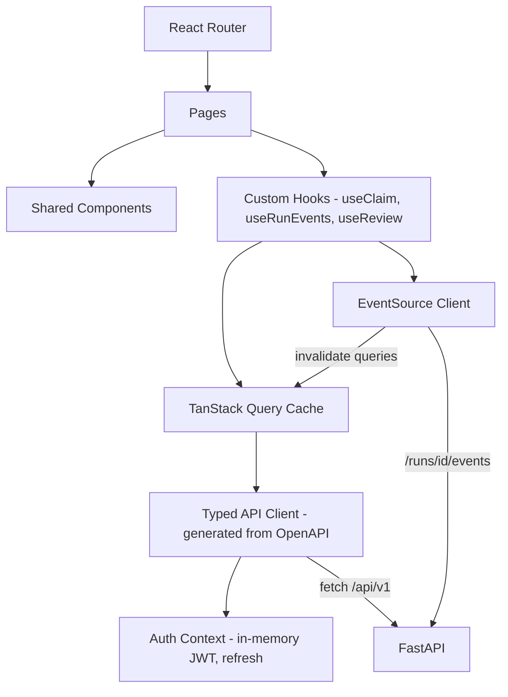

### 13.3 UX rules derived from the source requirements

- **One-page first:** the dashboard opens on the one-page actionable summary (POC-OUT); details are one click away.
- **Every AI statement is clickable to its source:** citation chips open the viewer at the exact page and line (PW-4.2 traceability).
- **AI vs human provenance is visible:** badges show "AI draft", "Validated by <name>" and "Edited". Determinations are never shown as AI-made.
- **Flags are actionable inline:** one-click approve/reject with an optional reason; a reason is mandatory for overrides (POC-7).
- **Urgency surfaces first:** urgent flags and SLA due dates sort to the top of queues (PW-1.2).
- **Live progress:** a stage stepper (Stages 1–7) driven by SSE shows the current node, retries and HITL waits.
- **Accessibility:** WCAG 2.1 AA, keyboard-first review screens, no PHI in browser storage, auto-logout after 15 minutes idle.

---

## 14. Error Handling and Resilience

### 14.1 Error taxonomy

| Class | Examples | Handling |
|---|---|---|
| `TransientExternalError` | Gemini 429 (rate/quota), 500/503, timeouts, network errors | Exponential backoff with jitter (1s, 2s, 4s, 8s, 16s; max 5), honour `Retry-After`; rate limiter slows global throughput; circuit breaker opens after 5 consecutive failures for 60 s → run state `retrying` |
| `QuotaExhaustedError` | Daily AI Studio quota reached | Run paused (`retrying` with `available_at` = quota reset); supervisor notified; no data loss thanks to checkpoint |
| `LLMOutputError` | Invalid JSON, schema violation, missing citations | One automatic **repair** retry including the validation errors in the prompt; then fall back to `MODEL_REASONING`; then mark items `needs_review` (HITL) |
| `SafetyBlockError` | Response blocked by safety filters | Log the safety ratings; retry with adjusted safety settings for clinical content; else route the item to human |
| `LowConfidence` | Confidence below threshold | Not an error: routed to the relevant HITL checkpoint |
| `DocumentProcessingError` | Corrupt PDF, password-protected file, unreadable fax | Document marked `failed` with reason; run continues with the other documents; gap flagged and `document_requests` created |
| `ValidationError` (business) | MMI date before DOI; contradicting facts | `discrepancies` created → HITL-2 |
| `ToolExecutionError` | Report rendering failure, CMS connector down | Tool-level retry; CMS sync is queued in `cms_sync_log` with retries (outbox pattern), never blocking decision recording |
| `FatalError` | Programming error, DB integrity error | Step `failed`, run `failed`, alert; supervisor can **retry from checkpoint** after fix |

### 14.2 Resilience mechanisms

- **Checkpoint after every node:** a crash or deploy mid-run resumes at the last completed node (`graph.invoke(None, config)`).
- **Idempotent nodes:** outputs are upserted by `(run_id, node, item_key)` so a retried node never duplicates facts or documents.
- **Per-item isolation in fan-out:** one failed document classification does not fail the batch. Failed items are collected in `errors` and handled by the supervisor router.
- **Timeouts:** per-tool (e.g. OCR page 60 s), per-node (e.g. 15 min) and per-run soft limits.
- **Dead-letter:** jobs exceeding `max_attempts` move to `failed` and appear in the supervisor console with error details and a "retry" action.
- **Graceful degradation:** if Gemini is unavailable, ingestion, rendering, native-text extraction, hashing and search still work; AI stages wait.
- **Outbox pattern** for external side effects (CMS, email) so DB commits and external calls stay consistent.
- **HITL SLA timers:** a scheduler in the worker escalates pending reviews past `due_at` to the supervisor and marks them `expired` if configured.

### 14.3 Error flow

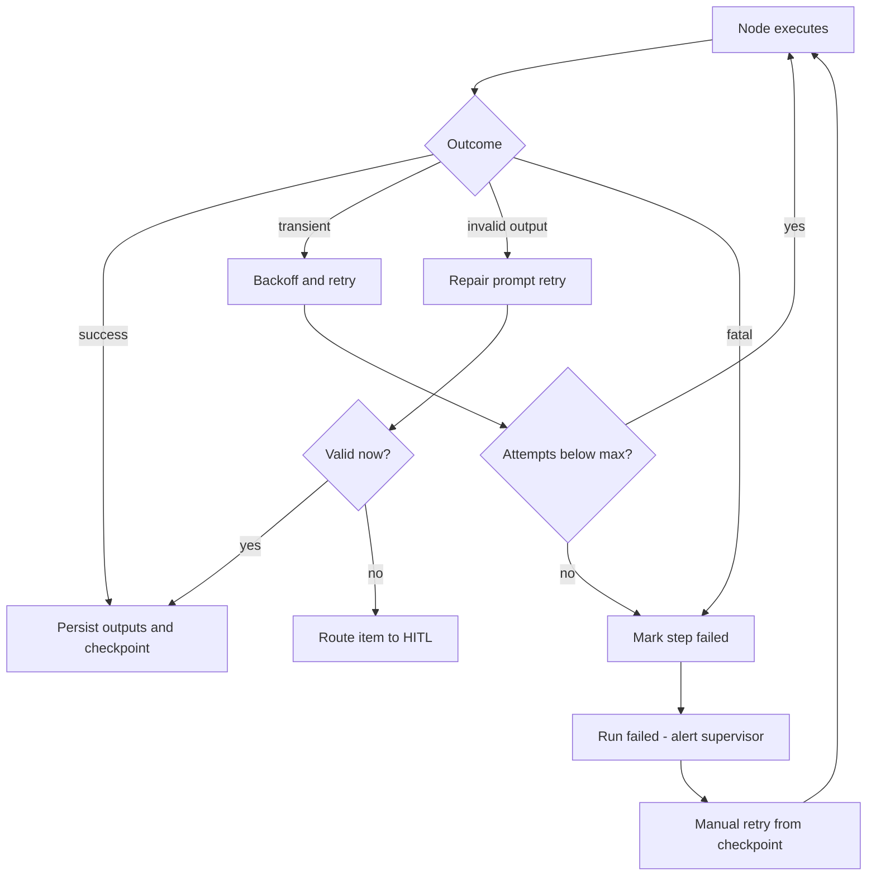

---

## 15. Security and Compliance

### 15.1 Regulatory context

Medical records in WC claims contain **Protected Health Information (PHI)** and PII. WC insurers are not always HIPAA covered entities, but providers sending records are, and state privacy laws, GLBA, and carrier and TPA policies apply. The system is designed to **HIPAA Security Rule** standards (administrative, physical and technical safeguards) plus **state WC confidentiality rules** (e.g. Pennsylvania for the sample claim).

> **Important: Google AI Studio API keys and PHI.** Google's terms for the **free tier** of the Gemini API allow prompts and responses to be used to improve products and do not provide a Business Associate Agreement (BAA). **Do not send real PHI through free-tier AI Studio keys.** For the PoC, use synthetic or de-identified data (e.g. the sample package). For production: (a) use a **paid-tier** Gemini API project, where data is not used for training; and (b) preferably move to **Gemini on Vertex AI** under a Google Cloud BAA, with regional data residency, VPC Service Controls and CMEK. The LLM gateway (§5.6) makes this a configuration switch.

### 15.2 Controls

| Area | Control |
|---|---|
| Authentication | Argon2id password hashing, optional TOTP MFA (mandatory for supervisor/admin), OIDC SSO in production; JWT access tokens (15 min, RS256) plus rotating httpOnly, Secure, SameSite=Strict refresh cookies; account lockout after 5 failed attempts |
| Authorization | RBAC (§3) plus **claim-level access** (assignment or team membership) checked in every query (`WHERE claim_id IN user_scope`); deny by default |
| Secrets | `GEMINI_API_KEY`, JWT keys and DB encryption key in `.env` (dev) or OS secret store / Vault / Google Secret Manager (prod); never committed (`.gitignore`), never sent to the frontend, never logged; key rotation procedure documented |
| Data in transit | TLS 1.2+ at the reverse proxy; HSTS; Gemini over HTTPS |
| Data at rest | Full-disk encryption; encrypted file store (AES-256-GCM, per-file data keys wrapped by a master key); PHI columns field-encrypted (`_enc`) or the SQLCipher database; encrypted backups |
| Prompt-injection defense | Document text is placed in delimited **data blocks** with a system instruction that content is untrusted data, not instructions; agents have **no free-form tool access**. Tools are fixed per node with allow-listed arguments; outputs are schema-validated; no agent can send email or call external URLs from document content. |
| Output safety | Grounding validation (no ungrounded facts); determinations are human-only; disclaimers on AI drafts |
| Data minimization | Only the required pages/episodes are sent to the LLM; SSNs and full DOBs are masked in prompts unless needed (e.g. replace with `[SSN]`) |
| Logging hygiene | PHI redaction filter on application logs (names, DOB, SSN, addresses via regex plus the claimant dictionary); LLM request/response bodies stored only encrypted in `llm_calls` with configurable retention |
| Upload security | MIME sniffing, size limits (e.g. 200 MB per file, 2,000 pages per claim run), ClamAV scan, PDF sanitization (no JavaScript execution), randomized storage names |
| API security | Input validation (Pydantic), rate limiting (`slowapi`), CORS locked to origin, security headers (CSP, X-Frame-Options, Referrer-Policy), CSRF protection on cookie-auth endpoints, OWASP ASVS L2 checklist |
| Separation of duties | §3.3; supervisor sign-off for overrides and high-risk claims |
| Retention and deletion | Configurable per jurisdiction (e.g. 7–10 years after claim closure); legal hold flag; secure deletion jobs; LLM bodies purged after N days |
| Access reviews | Quarterly role review reports from `user_roles` and `audit_log` |

### 15.3 Threat model summary

| Threat | Mitigation |
|---|---|
| Unauthorized PHI access | RBAC plus claim scoping, MFA, audit of `phi.view`, anomaly report (bulk views) |
| Malicious document (malware, prompt injection) | AV scan, sanitization, untrusted-data prompting, fixed tools, schema validation |
| LLM hallucination leading to a wrong decision | Citations, Validation Agent, HITL-2/3/4, "zero extrapolation" rule |
| API key leakage | Server-side only, secret store, rotation, egress logging |
| Audit tampering | Append-only triggers, hash chain, off-host log shipping |
| Data loss | WAL, Litestream/backups, restore drills |

---

## 16. Logging, Monitoring and Audit Trails

### 16.1 Logging

- **Structured JSON logs** (`structlog`) to stdout → file/collector. Fields: `ts`, `level`, `service` (`api`/`worker`), `correlation_id`, `run_id`, `claim_id` (ID only), `node`, `tool`, `user_id`, `event`, `duration_ms`, `error_type`.
- A **correlation ID** is created per HTTP request (`X-Request-ID`) and per run; it is propagated into agent steps, tool calls, LLM calls and audit entries, so one search reconstructs everything.
- Log levels: INFO for state transitions, DEBUG (dev only) for prompts. PHI redaction filter applies to all levels.

### 16.2 Agent observability (tracing)

| Signal | Source | Use |
|---|---|---|
| Run/step traces | `agent_runs`, `agent_steps`, OpenTelemetry spans (`opentelemetry-instrumentation-fastapi`, custom spans per node/tool/LLM call) | Visualize execution per claim; find slow nodes |
| LLM telemetry | `llm_calls` | Tokens, latency, cost, failures, safety blocks by model and prompt version |
| Optional | LangSmith or Langfuse (self-hosted for PHI) for LangGraph trace visualization; disabled by default for PHI | Debugging prompts |

### 16.3 Monitoring metrics and alerts

| Metric | Type | Alert threshold (initial) |
|---|---|---|
| `runs_started_total`, `runs_completed_total`, `runs_failed_total` | counter | failure rate > 5% per hour |
| `stage_duration_seconds{stage}` | histogram | p95 Stage 2 > 10 min for a 300-page claim |
| `hitl_wait_seconds{checkpoint}` | histogram | pending > SLA (e.g. HITL-1 24 h, HITL-4 48 h) |
| `llm_requests_total{model,status}`, `llm_tokens_total`, `llm_cost_usd_total` | counter | 429 rate > 10%; daily cost > budget |
| `llm_latency_seconds{model}` | histogram | p95 > 60 s |
| `validation_rejection_ratio` | gauge | > 15% (prompt or model regression) |
| `human_override_ratio{flag_type}` | gauge | > 30% (AI quality issue) |
| `jobs_queue_depth`, `worker_heartbeat_age_seconds` | gauge | depth > 50; heartbeat > 60 s |
| `sqlite_busy_errors_total` | counter | > 0 sustained (contention: consider Postgres) |

Exposed at `/metrics` (Prometheus); dashboards in Grafana. The supervisor console shows a business view: claims by stage, SLA breaches, average review time, pages processed, and estimated hours saved.

### 16.4 Audit trail design

**What is audited** (`audit_log`, append-only, hash-chained):

| Category | Actions |
|---|---|
| Data access | `phi.view` (page image/text, summary, report), `report.export`, `search.execute` |
| Data changes | `claim.create/update`, `baseline.lock`, `document.upload/split/reclassify`, `fact.accept/edit/reject`, `summary.edit/approve`, `chronology.edit` |
| AI actions | `agent.step.completed` (node, run, output refs), `llm.call` (model, prompt version, token counts; reference to the encrypted body), `ai.flag.created` |
| Human decisions | `review.submit` (checkpoint, response), `flag.approve/reject/modify` with reason, `decision.create`, `ur.determination`, `decision.signoff`, `override` |
| Security | `auth.login/logout/failed`, `role.grant/revoke`, `config.change`, `prompt.publish`, `api_key.rotate` |
| Integrations | `cms.sync` (payload hash, status) |

**Integrity:** each row stores `hash = SHA-256(prev_hash || canonical_json(row))`. `/audit/verify` recomputes the chain; nightly export to WORM storage (e.g. S3 Object Lock) for production.

**Decision traceability (PW-7.3):** for any decision the system can render a **Decision Provenance Report** listing: the decision → the reviewer and rationale → the flags approved or overridden → the AI drafts (prompt version, model) → the validated facts → the citations → the source pages, plus the timeline of who did what. This satisfies "another reviewer can understand how the decision was reached".

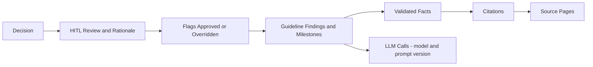

---

## 17. Evaluation and Quality Assurance

### 17.1 Golden dataset

- **Primary:** the sample package from the PoC: claimant Marcus T. Delgado, claim WC-2024-PA-087341, DOI 09/14/2024, 287 pages, 9 document types (Appendix A). Create a **gold annotation** for it: document boundaries and types, episode grouping, all milestone facts (MMI, RTW, surgery date, diagnoses, restrictions, FCE classification), expected guideline flags, and a reference chronology and one-page summary written by an NCM.
- **Secondary:** 10–20 additional synthetic or de-identified packages covering IME reports, chiropractic and pain management, conflicting MMI opinions, missing operative reports, excessive PT, opioid escalation and denied surgery.

### 17.2 Metrics and targets (PoC)

| Area | Metric | Target |
|---|---|---|
| Intake | Baseline field accuracy | 100% after HITL-0 (≥ 98% before) |
| Packet splitting | Boundary F1 | ≥ 0.95 |
| Classification | Document-type accuracy / macro-F1 | ≥ 0.95 / ≥ 0.90 |
| Deduplication | Duplicate detection precision / recall | ≥ 0.98 / ≥ 0.95 |
| Extraction | Field-level F1 for MMI, RTW, treatment plan | ≥ 0.90 |
| Grounding | Citation correctness (quote supports value) | ≥ 0.98; ungrounded facts in final output = 0 |
| Summary | NCM rubric score (accuracy, completeness, relevance, concision, 1–5) | ≥ 4.2 average; one page |
| Guideline | Flag precision / recall vs reviewer | ≥ 0.80 / ≥ 0.85 |
| Efficiency | Human review time per claim vs manual baseline | ≥ 60% reduction |
| Operations | End-to-end AI processing time for 300 pages (excluding HITL) | ≤ 15 min |

### 17.3 Testing strategy

| Level | Approach |
|---|---|
| Unit | Tools (date parsing, dedup, timeline sort, duration calculator, hash chain), repositories, Pydantic schemas (pytest) |
| Prompt/agent | Recorded LLM fixtures (VCR-style) for deterministic CI; schema-conformance tests; prompt regression suite scoring against gold annotations on each prompt version |
| Integration | FastAPI `TestClient` plus a temporary SQLite; full graph run with a fake LLM; HITL interrupt and resume tests |
| E2E | Playwright: upload sample package → approve HITL-1 → validate facts → approve summary → decide → sign off |
| Non-functional | Load (Locust) for API and SSE; chaos tests (kill worker mid-run, simulate 429); security (OWASP ZAP, dependency audit with `pip-audit` and `npm audit`) |
| Human feedback loop | Every HITL edit or rejection is stored as labeled data; weekly review of override ratios; few-shot examples and prompts updated through versioned `prompt_templates` |

---

## 18. Project Structure and Step-by-Step Implementation Guide

### 18.1 Repository layout

```text
claims-ai/
├── backend/
│   ├── app/
│   │   ├── main.py                    # FastAPI app factory, routers, middleware
│   │   ├── worker.py                  # job poller, graph runner, scheduler (SLA timers)
│   │   ├── config.py                  # pydantic-settings (.env)
│   │   ├── api/v1/                    # routers: auth, claims, documents, runs, timeline,
│   │   │                              #          facts, guidelines, summaries, reports,
│   │   │                              #          reviews, flags, decisions, audit, admin, health
│   │   ├── core/                      # security (jwt, rbac), logging, errors, correlation ids
│   │   ├── db/                        # engine, session, pragmas, base models
│   │   ├── models/                    # SQLAlchemy ORM models
│   │   ├── schemas/                   # Pydantic request/response + LLM output schemas
│   │   ├── repositories/              # data access per aggregate
│   │   ├── services/                  # run service, review service, report service, audit service
│   │   ├── orchestration/
│   │   │   ├── state.py               # ClaimWorkflowState
│   │   │   ├── graph.py               # StateGraph build, edges, interrupts
│   │   │   ├── supervisor.py          # routing rules
│   │   │   ├── decorators.py          # @agent_node
│   │   │   └── checkpointer.py        # SqliteSaver setup
│   │   ├── agents/
│   │   │   ├── intake.py  classification.py  organization.py  clinical_summary.py
│   │   │   ├── utilization.py  extraction/{mmi,rtw,treatment_plan,clinical,turning_points}.py
│   │   │   ├── validation.py  guideline.py  chronology.py  report.py
│   │   │   ├── decision_support.py  routing.py  record_keeping.py  hitl.py
│   │   │   └── prompts/               # versioned prompt templates (.jinja) + few-shot examples
│   │   ├── tools/                     # registry.py + one module per tool (§8)
│   │   ├── llm/                       # gateway.py, rate_limiter.py, models.py, redaction.py
│   │   ├── integrations/cms/          # base.py, mock.py
│   │   └── templates/reports/         # Jinja2 HTML templates for PDF/DOCX
│   ├── alembic/                       # migrations (render_as_batch)
│   ├── tests/                         # unit, integration, fixtures (gold annotations)
│   ├── requirements.txt
│   └── .env.example
├── frontend/
│   ├── src/
│   │   ├── api/                       # generated OpenAPI types + client
│   │   ├── auth/                      # AuthProvider, ProtectedRoute
│   │   ├── hooks/                     # useClaim, useRunEvents (SSE), useReview
│   │   ├── pages/                     # routes in §13.1
│   │   ├── components/                # viewer, timeline, tables, forms
│   │   └── main.tsx, App.tsx
│   ├── package.json
│   └── vite.config.ts
├── data/                              # app.db, checkpoints.db, files/ (git-ignored)
├── deploy/                            # nginx.conf, docker-compose.yml, litestream.yml
└── docs/                              # this document, ADRs
```

### 18.2 Key dependencies

**Backend (`requirements.txt`)**

```text
fastapi
uvicorn[standard]
pydantic>=2
pydantic-settings
sqlalchemy>=2
alembic
sse-starlette
python-multipart
langgraph
langgraph-checkpoint-sqlite
google-genai
sqlite-vec
pypdf
pdfplumber
pypdfium2
pillow
python-magic
extract-msg
dateparser
rapidfuzz
jinja2
weasyprint
python-docx
argon2-cffi
pyjwt[crypto]
cryptography
slowapi
structlog
prometheus-client
opentelemetry-sdk
opentelemetry-instrumentation-fastapi
tenacity
pytest
httpx
```

**Frontend (`package.json` dependencies)**

```text
react, react-dom, react-router-dom, @tanstack/react-query, @mui/material (or shadcn/ui + tailwindcss),
react-pdf, react-hook-form, zod, date-fns, recharts (timeline/metrics), openapi-typescript (dev),
vite, typescript, @playwright/test (dev), vitest (dev)
```

### 18.3 Environment configuration (`.env.example`)

```text
APP_ENV=development
DATABASE_URL=sqlite:///./data/app.db
CHECKPOINT_DB_PATH=./data/checkpoints.db
FILE_STORE_PATH=./data/files
FILE_ENCRYPTION_KEY=<base64-32-bytes>
JWT_PRIVATE_KEY_PATH=./secrets/jwt.pem
JWT_PUBLIC_KEY_PATH=./secrets/jwt.pub
GEMINI_API_KEY=<from Google AI Studio - server side only>
GEMINI_MODEL_FAST=gemini-2.5-flash
GEMINI_MODEL_REASONING=gemini-2.5-pro
GEMINI_EMBED_MODEL=gemini-embedding-001
GEMINI_RPM_LIMIT=60
GEMINI_TPM_LIMIT=1000000
CONFIDENCE_THRESHOLD_CLASSIFICATION=0.85
CONFIDENCE_THRESHOLD_FACT=0.90
RISK_ESCALATION_THRESHOLD=0.7
LLM_BODY_RETENTION_DAYS=30
ALLOW_PHI_TO_LLM=false     # must be true only on paid tier or Vertex AI with BAA
```

### 18.4 Phased implementation plan

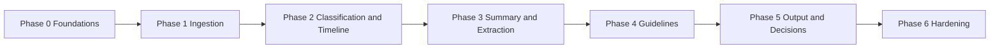

| Phase | Duration (est.) | Build steps | Exit criteria |
|---|---|---|---|
| **0. Foundations** | 1–2 weeks | (1) Create repo, backend and frontend scaffolds. (2) `config.py`, structured logging, correlation-ID middleware, error handlers (RFC 7807). (3) SQLAlchemy engine with SQLite pragmas; Alembic init; identity tables; seed roles and permissions. (4) JWT auth, RBAC dependency, login UI, protected routes. (5) `audit_log` with hash chain plus audit service. (6) `jobs` table and worker skeleton with heartbeat. (7) LLM gateway: Gemini client, rate limiter, retry, `llm_calls` logging, structured output helper. (8) LangGraph skeleton with SQLite checkpointer and a dummy two-node graph with one `interrupt`; SSE endpoint and `useRunEvents` hook. | Login works; a dummy run streams events, pauses and resumes from the UI; audit chain verifies |
| **1. Ingestion (Stage 1)** | 2 weeks | (1) Claims API and UI (baseline form). (2) Upload API (multipart and chunked), file encryption, MIME check, AV hook. (3) `pdf_render_tool`, `ocr_tool` (Gemini vision), `page_lines`. (4) `packet_splitter_tool`, stream routing. (5) `dedup_tool`. (6) `intake_agent`: baseline extraction, completeness checklist, urgency rules, review-context draft. (7) HITL-0 UI. (8) Document viewer with page images. | Sample 287-page package ingested; baseline 100% after HITL-0; duplicates removed; streams correct |
| **2. Classification and Timeline (Stage 2)** | 2 weeks | (1) Document taxonomy and `classifier_tool` with few-shot examples. (2) `classification_agent` with `Send` fan-out. (3) FTS5 plus embeddings indexing; hybrid search API/UI. (4) `organization_agent`: sort, episodes, noise removal, gap detection. (5) Supervisor router (reclassify loop, request documents). (6) HITL-1 Timeline UI. | Classification accuracy ≥ 0.95 on gold; NCM can approve and correct timeline; loop works |
| **3. Summary and Extraction (Stages 3–4)** | 3 weeks | (1) Clinical summary agent (map-reduce, citations). (2) Utilization agent (drafts, issues). (3) Extraction sub-graph (MMI, RTW, treatment plan, clinical facts). (4) Validation agent (quote match, judge, consistency rules). (5) HITL-2 side-by-side validation UI. (6) Turning-point detector; milestone strip on dashboard. | Extraction F1 ≥ 0.90; zero ungrounded facts reach output |
| **4. Guidelines (Stage 5)** | 2 weeks | (1) Guideline source/rule tables and admin import. (2) Retrieval tool (filters plus hybrid search). (3) Duration calculator. (4) Guideline agent (narrative arc, milestone impacts, deviations). (5) Findings UI with accept/dismiss. | Flags on gold match reviewer expectations (P ≥ 0.80, R ≥ 0.85) |
| **5. Output and Decisions (Stages 6–7)** | 2–3 weeks | (1) Chronology agent and editable table. (2) Report agent plus templates (one-page summary, MMI status, chronology, case progress) with PDF/DOCX export. (3) HITL-3 summary review with version diff and regenerate. (4) Decision support plus routing agent (risk scoring, assignments, notifications). (5) HITL-4 decision workspace with one-click flag approvals and UR determination form. (6) HITL-5 supervisor console. (7) Record keeping, Decision Provenance Report, mock CMS connector. | Full E2E on sample claim by all personas; decision record traceable to source pages |
| **6. Hardening** | 2 weeks | (1) Security review (OWASP ASVS, ZAP, dependency audits), PHI redaction verification. (2) Metrics, dashboards, alerts. (3) Backups/Litestream and restore drill. (4) Performance tuning (concurrency limits, caching of page text, prompt size). (5) Chaos tests (worker kill, 429 storms). (6) User acceptance testing with each persona; documentation and runbooks. | UAT sign-off; SLOs met; runbooks complete |

### 18.5 Implementation details for critical pieces

**Graph construction (`orchestration/graph.py`)**

```python
from langgraph.graph import StateGraph, START, END
from langgraph.checkpoint.sqlite import SqliteSaver
import sqlite3

def build_graph():
    g = StateGraph(ClaimWorkflowState)
    for name, fn in NODES.items():          # intake_agent, classification_agent, ...
        g.add_node(name, fn)
    g.add_edge(START, "intake_agent")
    g.add_conditional_edges("intake_agent", baseline_gate,
                            {"confirm": "hitl_baseline", "ok": "classification_agent"})
    g.add_edge("hitl_baseline", "classification_agent")
    g.add_edge("classification_agent", "organization_agent")
    g.add_edge("organization_agent", "hitl_timeline_check")
    g.add_conditional_edges("hitl_timeline_check", supervisor_router,
                            {"reclassify": "classification_agent",
                             "request_documents": "await_documents",
                             "continue": "clinical_summary_agent"})
    # ... remaining edges per §6.2 ...
    g.add_edge("cms_sync", END)
    conn = sqlite3.connect(settings.CHECKPOINT_DB_PATH, check_same_thread=False)
    return g.compile(checkpointer=SqliteSaver(conn))
```

**Structured extraction call (`llm/gateway.py`)**

```python
from google import genai
from google.genai import types

client = genai.Client(api_key=settings.GEMINI_API_KEY)

def generate_structured(prompt: str, schema: type[BaseModel], tier: str, ctx) -> BaseModel:
    model = settings.GEMINI_MODEL_FAST if tier == "fast" else settings.GEMINI_MODEL_REASONING
    with ctx.rate_limiter(model), ctx.llm_call_logger(model, prompt) as log:
        resp = client.models.generate_content(
            model=model,
            contents=prompt,
            config=types.GenerateContentConfig(
                temperature=0,
                response_mime_type="application/json",
                response_schema=schema,
            ),
        )
        log.record(resp.usage_metadata, resp.candidates[0].finish_reason)
    return schema.model_validate_json(resp.text)   # raises -> repair retry
```

**SSE endpoint (`api/v1/runs.py`)**

```python
from sse_starlette.sse import EventSourceResponse

@router.get("/runs/{run_id}/events")
async def run_events(run_id: str, request: Request, user=Depends(require_permission("document:view_phi"))):
    last_id = int(request.headers.get("last-event-id", 0))
    async def stream():
        nonlocal last_id
        while not await request.is_disconnected():
            for ev in await repo.run_events_after(run_id, last_id):
                last_id = ev.id
                yield {"id": ev.id, "event": ev.event_type, "data": ev.data}
            await asyncio.sleep(1)
    return EventSourceResponse(stream())
```

### 18.6 Definition of done (per feature)

Code reviewed; unit and integration tests pass; prompt regression suite passes against gold; audit events emitted; RBAC enforced and tested; metrics and logs present; no PHI in logs; OpenAPI updated and frontend types regenerated; documentation updated.

---

## 19. Assumptions, Dependencies, Limitations and Future Improvements

### 19.1 Assumptions

1. The PoC uses **synthetic or de-identified** data (including the Marcus T. Delgado sample) while on AI Studio keys. Real PHI requires the paid tier or Vertex AI with a BAA (§15.1).
2. Users are internal claims staff of one insurer/TPA (single tenant).
3. Volume for v1: up to ~50 claims per day, ≤ 2,000 pages per claim run, ≤ 25 concurrent users, which suits SQLite with one worker.
4. Jurisdiction for the sample is **Pennsylvania** (claim number `WC-2024-PA-...`); guideline and state-rule content is loaded per jurisdiction by admins.
5. The CMS is not integrated in v1; decisions are logged to a mock connector and exportable.
6. Gemini model names are configuration values; the newest stable Flash/Pro tiers available at implementation time are used.
7. The "Stages 1–8" subtitle in the Persona Walkthrough is a typo for the 7 defined stages (§2 note).
8. In the PoC sample header, "Employer: Sarah Whitfield, Meridian Risk Partners LLC" appears alongside a FROI from "Keystone Industrial Services". This design treats Keystone Industrial Services as the **employer** and Meridian Risk Partners LLC (Sarah Whitfield) as an **employer representative / risk-management contact**. The Intake Agent must flag such conflicts for HITL-0 confirmation, which makes this a useful test case.

### 19.2 Dependencies

| Dependency | Type | Risk | Mitigation |
|---|---|---|---|
| Google Gemini API (AI Studio) | External service | Quotas, rate limits, outages, model deprecations, data-use terms | Rate limiter, backoff, checkpoint resume, configurable models, Vertex AI path |
| Licensed guidelines (ODG by MCG, ACOEM) | Content license | Proprietary; cannot be scraped or relied on from model memory | License and import into `guideline_rules`; until then use state-published guidelines or a curated sample rule set for PoC |
| CPT codes (AMA) | Content license | Licensed code set | Use ICD-10-CM (public) and HCPCS Level II; license CPT for production |
| LangGraph, google-genai, sqlite-vec | OSS libraries | API changes | Pin versions; adapter layer; tests |
| OCR quality of faxes | Input quality | Low-resolution, skewed or handwritten pages reduce accuracy | Gemini vision, image pre-processing (deskew, denoise), OCR confidence → HITL |
| Domain experts (NCM, UR, adjusters) | People | Needed for gold annotations, HITL and UAT | Plan their time in Phases 1–6 |

### 19.3 Limitations

- **SQLite concurrency:** one writer at a time; fine for v1 but limits throughput with multiple workers. Not suitable for network file systems or multi-node deployment.
- **AI Studio limits:** free-tier RPM/TPM and daily quotas will throttle large packages; the paid tier is recommended even for the PoC at realistic volumes.
- **LLM non-determinism:** mitigated with temperature 0, schemas, validation and HITL, but not eliminated. The AI never makes final determinations.
- **Handwritten notes** and very poor faxes may be partially unreadable.
- **Guideline reasoning** is only as good as the loaded rule content; the agent declines to judge without a cited rule.
- **One-page constraint** may omit detail for very complex claims; the full chronology and case-progress report cover the rest.
- **No real-time CMS sync** or fax/email intake in v1.

### 19.4 Future improvements and scaling path

| Area | Improvement |
|---|---|
| Database | Migrate to PostgreSQL (`pgvector`, `tsvector`, `PostgresSaver`) when more than one worker or more than ~100 claims/day are needed |
| Queue / workers | Celery or Arq with Redis; horizontal workers; priority queues for urgent claims |
| Storage | S3/GCS object storage with KMS encryption; signed URLs for page images |
| LLM platform | Gemini on Vertex AI (BAA, regional, CMEK); model evaluation harness to compare models; context caching for long packages to cut cost |
| Intake connectors | Fax server, email (Microsoft Graph/IMAP), CMS webhooks, provider portals, EDI 275 attachments |
| Jurisdictions | Multi-state rule engine (state fee schedules, formularies, UR timelines, MMI/impairment rules); jurisdiction-specific report templates |
| Analytics | Claim exposure prediction, reserve recommendation, RTW duration prediction, provider performance insights, fraud/abuse indicators |
| Agentic enhancements | Autonomous document-chasing agent (drafts requests to providers for approval); IME scheduling assistant; conversational Q&A over a claim ("Ask the file") with citations; learning from HITL feedback (few-shot retrieval of past corrections) |
| Bill review | Link CMS-1500 bills to clinical encounters; detect unbundling, duplicate billing, fee-schedule variances |
| Multi-tenancy | Tenant isolation, per-tenant keys and configuration |
| Compliance | SOC 2 / HITRUST alignment, automated access reviews, DLP scanning on exports |

---

## 20. Appendices

### Appendix A — Sample medical record (from the PoC)

| Field | Value |
|---|---|
| Claimant | Marcus T. Delgado |
| Employer (as listed in PoC header) | Sarah Whitfield, Meridian Risk Partners LLC (see assumption §19.1-8) |
| Employer per FROI | Keystone Industrial Services |
| Insurer / TPA | PMA Companies / Lodestar Claims Management |
| Date of Injury | 09/14/2024 |
| Total Pages | 287 |
| Claim Number | WC-2024-PA-087341 |
| Assigned Adjuster | Jennifer Hartwell, AIC |

**Documents included and expected extracted fields** (these become the extraction schema and the gold-annotation checklist):

| # | Source / file | Document type | Fields the system must capture |
|---|---|---|---|
| 1 | Reading Hospital – Tower Health | Emergency Department Visit – Medical Record | Patient information (name, DOB, contact/insurance, employer, WC claim details); date and time of injury, where it occurred; mechanism of injury (lifting, falling, struck, exposure); chief complaint; history of present illness (symptoms, severity, onset, prior treatment, relevant history); physical examination findings; diagnostic testing (X-ray, CT/MRI, blood tests) and results; diagnosis; treatment provided (medications, wound care, splinting, procedures); discharge instructions (medications, activity restrictions, follow-up, warning signs); work status (return / modified / off work); provider information (clinician, facility, signatures, dates); WC documentation linking the condition to the workplace incident |
| 2 | Berks Orthopedics & Sports Medicine | Orthopedic Surgery Consultation | Reason for consultation; history of injury (how/when/where, mechanism); symptoms (pain location/severity, swelling, weakness, numbness, limited movement); prior treatment (ED care, medications, PT, injections, surgery); medical history (prior injuries, surgeries, conditions); physical exam (ROM, tenderness, strength, stability, swelling, neuro/vascular); imaging/tests and interpretation; assessment/diagnosis and work-relatedness; treatment plan (medication, PT, bracing, injections, surgery, more tests, observation); work restrictions (full/modified duty, lifting/movement limits, temporary disability); follow-up; **causation opinion** (caused or aggravated by workplace incident); provider details |
| 3 | Reading Hospital – L4-L5 Microdiscectomy | Operative Report | Patient and procedure information; date and location of surgery; preoperative diagnosis; postoperative diagnosis; procedure performed; surgeon and assisting personnel; anesthesia; indication for surgery; detailed procedure description; intraoperative findings; implants/devices; estimated blood loss; specimens; complications; post-surgery condition; postoperative plan/instructions; surgeon signature and date |
| 4 | HealthStar PT & Rehabilitation | Physical Therapy Progress Notes | Visit date; diagnosis/body part; subjective complaints (pain level, symptoms, functional difficulties, change since last visit); objective findings (ROM, strength, flexibility, gait, swelling); therapeutic exercises; manual therapy and other treatments; modalities (heat, ice, e-stim); patient response; progress toward goals; functional improvements/limitations; home exercise program; therapist assessment; plan for continued therapy; work restrictions/functional status; frequency/duration recommended; therapist signature and credentials |
| 5 | Giant Pharmacy #0412 | Pharmacy / Prescription Records | Medication name; dosage and strength; route; quantity; directions/frequency; prescription date; prescribing provider; pharmacy info; dispensing/fill date; refills; medication status (active/discontinued/completed); diagnosis/reason; WC claim/billing info; medication history relevant to injury; adverse reactions/allergies |
| 6 | Berks Orthopedics | Post-Op Follow-Up Notes | Visit date; surgery performed; postoperative diagnosis; symptoms (pain, swelling, numbness, stiffness); incision/wound assessment (healing, drainage, redness, infection); physical exam (ROM, strength, swelling, tenderness, neurovascular); imaging/diagnostics; assessment of recovery and surgical outcome; complications; medication management; PT/rehab recommendations; activity restrictions and precautions; work status (full / modified / TTD); plan for continued treatment; next follow-up; provider signature |
| 7 | Allied Rehab Services | Functional Capacity Evaluation (FCE) Report | Patient and evaluation info (date, diagnosis, referring provider, evaluator); reason for FCE; job requirements/physical demands; patient-reported symptoms; physical measurements (ROM, strength, endurance, balance); functional testing (lift, carry, push, pull, stand, walk, sit, bend, squat, kneel, reach, climb); weight-handling capacity; positional tolerances; consistency/effort observations; pain/symptom response; work capacity classification (sedentary/light/medium/heavy); functional limitations/restrictions; RTW recommendations; assessment (can meet job demands?); recommendations (therapy, accommodations, further evaluation); evaluator signature, credentials, date |
| 8 | Multiple Providers | Medical Bills / CMS-1500 Forms | Provider, dates of service, CPT/HCPCS, ICD-10 pointers, charges, units, place of service; used to corroborate the timeline and detect missing clinical records (billing stream) |
| 9 | Keystone Industrial Services | Employer's First Report of Injury (FROI) | Employer, employee, date/time/place of injury, description and mechanism, body part, witnesses, date reported, lost time; used for the baseline (PW-1.1) |

**Document types named in the source documents but not present in the sample**, which must still be supported: IME Reports, Treatment Plans, Rehab Notes (separate from PT), Provider Notes (general), Utilization Requests, Employer's Accident Report, Policy and Coverage Information, Work Status Slips, primary care, chiropractic and pain management records.

### Appendix B — Expected workflow on the sample claim (illustrative)

1. **Stage 1:** 287 pages ingested; FROI baseline: DOI 09/14/2024, lumbar spine (L4-L5), PA jurisdiction; the employer conflict flagged for HITL-0; review goal drafted, e.g. "Determine MMI status and RTW capacity post-microdiscectomy; assess ongoing PT necessity."
2. **Stage 2:** 9 document types classified; bills and pharmacy routed to separate streams; episodes formed: ED → ortho consult → surgery → post-op → PT course → FCE; duplicates and fax covers removed; NCM approves the timeline.
3. **Stage 3:** Clinical summary of the trajectory from acute injury through surgery to functional recovery; utilization draft for any PT extension request; issues such as pain scores vs FCE effort consistency.
4. **Stage 4:** MMI status (from post-op/FCE), RTW restrictions (from FCE and post-op work status), treatment plan; turning points: surgery date, FCE classification.
5. **Stage 5:** PT visit counts vs guideline; opioid duration vs guideline; stalled recovery check.
6. **Stage 6:** Chronology, one-page summary, MMI status report; NCM approves.
7. **Stage 7:** Examiner approves flags in one click, decides, e.g. on RTW with restrictions; supervisor sign-off if escalated; decision record sealed and logged to the (mock) CMS.

### Appendix C — Glossary

| Term | Meaning |
|---|---|
| ACOEM | American College of Occupational and Environmental Medicine practice guidelines |
| AIC | Associate in Claims (adjuster designation) |
| BAA | Business Associate Agreement (HIPAA) |
| CMS (in this document) | Claims Management System (not the Centers for Medicare & Medicaid Services) |
| CMS-1500 | Standard professional medical billing form |
| DOI | Date of Injury |
| ESI | Epidural Steroid Injection |
| FCE | Functional Capacity Evaluation |
| FROI | First Report of Injury (employer) |
| HITL | Human-in-the-loop |
| IME | Independent Medical Examination |
| MMI | Maximum Medical Improvement |
| NCM | Nurse Case Manager |
| ODG | Official Disability Guidelines (MCG Health) |
| PHI | Protected Health Information |
| PT | Physical Therapy |
| RTW | Return to Work |
| TPA | Third-Party Administrator |
| TTD / TPD | Temporary Total / Temporary Partial Disability |
| UR | Utilization Review |
| UW Manager | Underwriting Manager (named alongside Claims Supervisor in the source) |

### Appendix D — Architecture decision records (summary)

| ADR | Decision | Alternatives considered | Rationale |
|---|---|---|---|
| ADR-001 | LangGraph for orchestration | Custom orchestrator, Google ADK, CrewAI | Native durable checkpoints, `interrupt`/resume for HITL, conditional and parallel edges, SQLite checkpointer fits the stack |
| ADR-002 | Gemini via `google-genai` behind a gateway | LangChain chat model wrappers | Direct access to structured output, vision, embeddings and usage metadata; the gateway keeps the provider swappable (Vertex AI) |
| ADR-003 | Separate worker process with a SQLite `jobs` queue | FastAPI BackgroundTasks, Celery+Redis | Durable and retryable without new infrastructure; Celery path documented |
| ADR-004 | SSE for progress | WebSockets, polling | One-way stream, simple, proxy-friendly, auto-reconnect |
| ADR-005 | Separate `checkpoints.db` | Same DB file | Reduces write contention; independent lifecycle |
| ADR-006 | Citations at page and line granularity | Page-only | Required by PW-4.2 "page-and-line citations" |
| ADR-007 | Human-only determinations | Auto-approve high-confidence | Regulatory defensibility; POC-7 HITL validation |

---

*End of document.*
